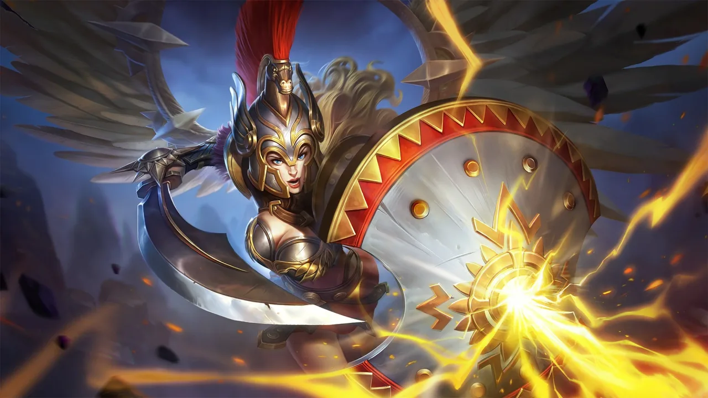

[Freya skins](https://boostmlbb.ru/en/skins/freya.html)

[Skins](https://boostmlbb.ru/en/skins/)/[Freya](https://boostmlbb.ru/en/skins/freya.html)/Gladiator

[Freya skin](https://boostmlbb.ru/en/skins/freya.html)

# Gladiator

CommonEliteIn the shop

How to get

Sold in the skin shop for 599 diamonds.

Price

599 diamonds

Released

2018

## What the skin changes

-   New look
-   Recoloured effects
-   Showcase animation
-   Attribute bonus

## Painted versions

The same skin in other colours. A painted version needs the skin itself.

-   **Spartan Spirit**StarLight reward for May 2020.

## All Freya skins [9](https://boostmlbb.ru/en/skins/freya.html)

[Galactic VanquisherSupreme · 2024](https://boostmlbb.ru/en/skins/freya/galactic-vanquisher.html)[S.A.B.E.R. ManhunterDeluxe · 2022](https://boostmlbb.ru/en/skins/freya/s-a-b-e-r-manhunter.html)[Raven ShogunDeluxe · 2020](https://boostmlbb.ru/en/skins/freya/raven-shogun.html)[Christmas CarnivalExceptional · 2018](https://boostmlbb.ru/en/skins/freya/christmas-carnival.html)[GladiatorCommon · 2018](https://boostmlbb.ru/en/skins/freya/gladiator.html)[Dragon HunterExceptional · 2017](https://boostmlbb.ru/en/skins/freya/dragon-hunter.html)[War AngelExquisite · 2017](https://boostmlbb.ru/en/skins/freya/war-angel.html)[Beach SweetheartExceptional · 2017](https://boostmlbb.ru/en/skins/freya/beach-sweetheart.html)[Dark RoseCommon · 2017](https://boostmlbb.ru/en/skins/freya/dark-rose.html)

## Elite series

[Golden OsmanthusChang'e · 2026](https://boostmlbb.ru/en/skins/change/golden-osmanthus.html)[Warlord KingMartis · 2025](https://boostmlbb.ru/en/skins/martis/warlord-king.html)[High Seas CadetKimmy · 2024](https://boostmlbb.ru/en/skins/kimmy/high-seas-cadet.html)[Verdant LancerSilvanna · 2024](https://boostmlbb.ru/en/skins/silvanna/verdant-lancer.html)[Bloodhoof MarauderHylos · 2024](https://boostmlbb.ru/en/skins/hylos/bloodhoof-marauder.html)[Elegant ButterflyGuinevere · 2024](https://boostmlbb.ru/en/skins/guinevere/elegant-butterfly.html)[Marques of BladesLancelot · 2024](https://boostmlbb.ru/en/skins/lancelot/marques-of-blades.html)[Badlands HiatusChip · 2024](https://boostmlbb.ru/en/skins/chip/badlands-hiatus.html)

**How much is a rank boost on Freya?**Choose your current and target ranks to see the price here.

[Calculate price](https://boostmlbb.ru/en/order.html?type=hero)

## Frequently asked questions

How to get the Gladiator skin for Freya?

Sold in the skin shop for 599 diamonds.

When was Gladiator released?

2018.

What class is Gladiator?

Common, Elite series.
