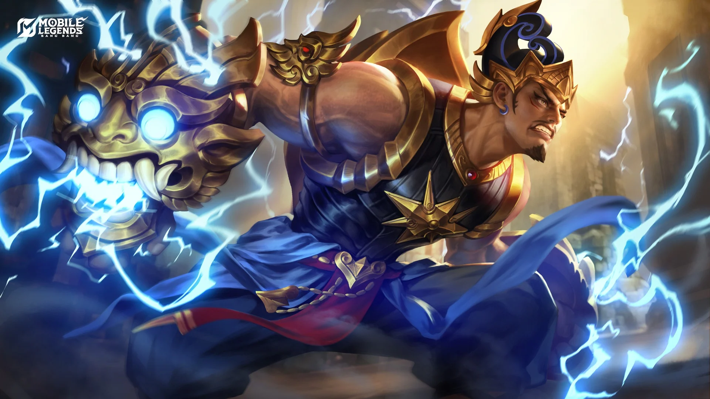

[All skins](https://boostmlbb.ru/en/skins/)

[Skins](https://boostmlbb.ru/en/skins/)/Gatotkaca

# Gatotkaca skins

Skins

7

In the shop

2

Latest

[Nutcracker Monarch](https://boostmlbb.ru/en/skins/gatotkaca/nutcracker-monarch.html)2024

[Hero profile→](https://boostmlbb.ru/en/heroes/gatotkaca.html)

## All skins

AllExquisiteDeluxeExceptionalCommon

[Nutcracker MonarchExceptional · 2024](https://boostmlbb.ru/en/skins/gatotkaca/nutcracker-monarch.html)[Tide PreserverDeluxe · 2024](https://boostmlbb.ru/en/skins/gatotkaca/tide-preserver.html)[SparkCommon · 2019](https://boostmlbb.ru/en/skins/gatotkaca/spark.html)[SentinelExquisite · 2018](https://boostmlbb.ru/en/skins/gatotkaca/sentinel.html)[Arhat KingCommon · 2018](https://boostmlbb.ru/en/skins/gatotkaca/arhat-king.html)[Mighty GuardianCommon · 2017](https://boostmlbb.ru/en/skins/gatotkaca/mighty-guardian.html)[Solar Spark](https://boostmlbb.ru/en/skins/gatotkaca/solar-spark.html)

**How much is a rank boost on Gatotkaca?**Choose your current and target ranks to see the price here.

[Calculate price](https://boostmlbb.ru/en/order.html?type=hero)

## Frequently asked questions

How many skins does Gatotkaca have?

7 skins, the default look not counted. The newest is Nutcracker Monarch (1 August 2024).

Which Gatotkaca skins can you buy now?

Tide Preserver (899 diamonds), Mighty Guardian (269 diamonds). The other skins were limited and come back only in events.

What is the rarest Gatotkaca skin?

Sentinel, Exquisite class, Luckybox series. Came out of Lucky Boxes in events. Limited skins come back in event draws from time to time.
