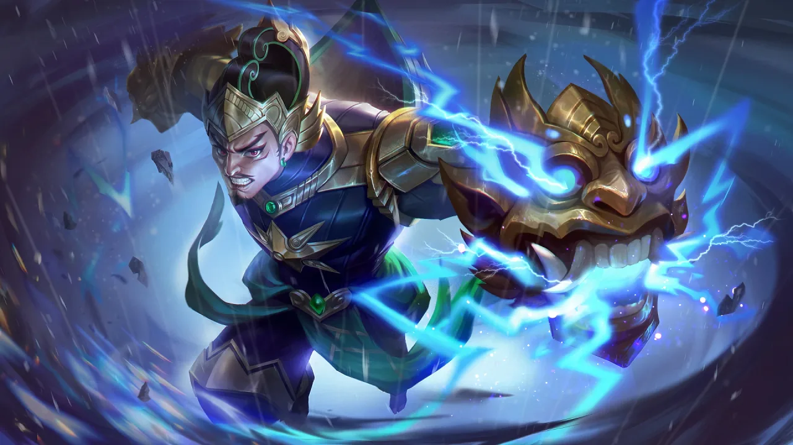

[Tier list](https://boostmlbb.ru/en/heroes/)[Items](https://boostmlbb.ru/en/items/)[Skins](https://boostmlbb.ru/en/skins/)[News & guides](https://boostmlbb.ru/en/news/)

[Skins](https://boostmlbb.ru/en/skins/)/[Gatotkaca](https://boostmlbb.ru/en/skins/gatotkaca.html)/Mighty Guardian

[Gatotkaca skin](https://boostmlbb.ru/en/skins/gatotkaca.html)

# Mighty Guardian

CommonIn the shop

How to get

Sold in the skin shop for 269 diamonds.

Price

269 diamonds

Released

11 August 2017

## What the skin changes

-   Attribute bonus

## All Gatotkaca skins [7](https://boostmlbb.ru/en/skins/gatotkaca.html)

[Nutcracker MonarchExceptional · 2024](https://boostmlbb.ru/en/skins/gatotkaca/nutcracker-monarch.html)[Tide PreserverDeluxe · 2024](https://boostmlbb.ru/en/skins/gatotkaca/tide-preserver.html)[SparkCommon · 2019](https://boostmlbb.ru/en/skins/gatotkaca/spark.html)[SentinelExquisite · 2018](https://boostmlbb.ru/en/skins/gatotkaca/sentinel.html)[Arhat KingCommon · 2018](https://boostmlbb.ru/en/skins/gatotkaca/arhat-king.html)[Mighty GuardianCommon · 2017](https://boostmlbb.ru/en/skins/gatotkaca/mighty-guardian.html)[Solar Spark](https://boostmlbb.ru/en/skins/gatotkaca/solar-spark.html)

**Rank up on Gatotkaca**The calculator shows the price

[Calculate price](https://boostmlbb.ru/en/order.html?type=hero)

## Frequently asked questions

How to get the Mighty Guardian skin for Gatotkaca?

Sold in the skin shop for 269 diamonds.

When was Mighty Guardian released?

11 August 2017.

What class is Mighty Guardian?

Common.
