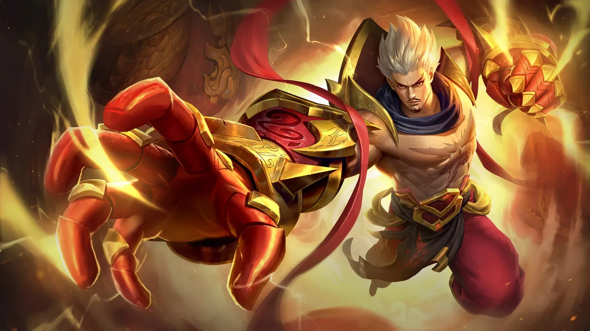

[Gatotkaca skins](https://boostmlbb.ru/en/skins/gatotkaca.html)

[Skins](https://boostmlbb.ru/en/skins/)/[Gatotkaca](https://boostmlbb.ru/en/skins/gatotkaca.html)/Spark

[Gatotkaca skin](https://boostmlbb.ru/en/skins/gatotkaca.html)

# Spark

CommonEliteLimited

How to get

Released in the skin shop during an event. Limited skins come back in event draws from time to time.

Released

7 October 2019

## What the skin changes

-   New look
-   Recoloured effects
-   Showcase animation
-   Attribute bonus

## All Gatotkaca skins [7](https://boostmlbb.ru/en/skins/gatotkaca.html)

[Nutcracker MonarchExceptional · 2024](https://boostmlbb.ru/en/skins/gatotkaca/nutcracker-monarch.html)[Tide PreserverDeluxe · 2024](https://boostmlbb.ru/en/skins/gatotkaca/tide-preserver.html)[SparkCommon · 2019](https://boostmlbb.ru/en/skins/gatotkaca/spark.html)[SentinelExquisite · 2018](https://boostmlbb.ru/en/skins/gatotkaca/sentinel.html)[Arhat KingCommon · 2018](https://boostmlbb.ru/en/skins/gatotkaca/arhat-king.html)[Mighty GuardianCommon · 2017](https://boostmlbb.ru/en/skins/gatotkaca/mighty-guardian.html)[Solar Spark](https://boostmlbb.ru/en/skins/gatotkaca/solar-spark.html)

## Elite series

[Golden OsmanthusChang'e · 2026](https://boostmlbb.ru/en/skins/change/golden-osmanthus.html)[Warlord KingMartis · 2025](https://boostmlbb.ru/en/skins/martis/warlord-king.html)[High Seas CadetKimmy · 2024](https://boostmlbb.ru/en/skins/kimmy/high-seas-cadet.html)[Verdant LancerSilvanna · 2024](https://boostmlbb.ru/en/skins/silvanna/verdant-lancer.html)[Bloodhoof MarauderHylos · 2024](https://boostmlbb.ru/en/skins/hylos/bloodhoof-marauder.html)[Elegant ButterflyGuinevere · 2024](https://boostmlbb.ru/en/skins/guinevere/elegant-butterfly.html)[Marques of BladesLancelot · 2024](https://boostmlbb.ru/en/skins/lancelot/marques-of-blades.html)[Badlands HiatusChip · 2024](https://boostmlbb.ru/en/skins/chip/badlands-hiatus.html)

**How much is a rank boost on Gatotkaca?**Choose your current and target ranks to see the price here.

[Calculate price](https://boostmlbb.ru/en/order.html?type=hero)

## Frequently asked questions

How to get the Spark skin for Gatotkaca?

Released in the skin shop during an event. Limited skins come back in event draws from time to time.

When was Spark released?

7 October 2019.

What class is Spark?

Common, Elite series.
