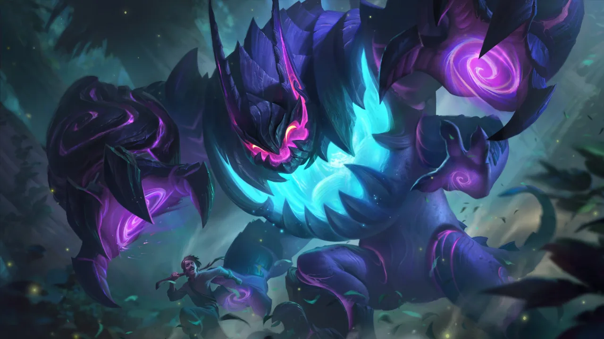

[All skins](https://boostmlbb.ru/en/skins/)

[Skins](https://boostmlbb.ru/en/skins/)/Gloo

# Gloo skins

Skins

4

In the shop

2

Latest

[Patrick](https://boostmlbb.ru/en/skins/gloo/patrick.html)2025

[Hero profile→](https://boostmlbb.ru/en/heroes/gloo.html)

## All skins

[PatrickDeluxe · 2025](https://boostmlbb.ru/en/skins/gloo/patrick.html)[JellymanExceptional · 2023](https://boostmlbb.ru/en/skins/gloo/jellyman.html)[Verdant EnchanterCommon · 2021](https://boostmlbb.ru/en/skins/gloo/verdant-enchanter.html)[Abominable Snowgloo](https://boostmlbb.ru/en/skins/gloo/abominable-snowgloo.html)

**How much is a rank boost on Gloo?**Choose your current and target ranks to see the price here.

[Calculate price](https://boostmlbb.ru/en/order.html?type=hero)

## Frequently asked questions

How many skins does Gloo have?

4 skins, the default look not counted. The newest is Patrick (21 December 2025).

Which Gloo skins can you buy now?

Jellyman (749 diamonds), Verdant Enchanter (269 diamonds). The other skins were limited and come back only in events.

What is the rarest Gloo skin?

Patrick, Deluxe class, SpongeBob series. Released in the MLBB × SpongeBob collaboration event. Limited skins come back in event draws from time to time.
