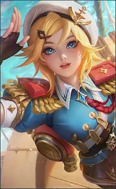

[Gloo skins](https://boostmlbb.ru/en/skins/gloo.html)

[Skins](https://boostmlbb.ru/en/skins/)/[Gloo](https://boostmlbb.ru/en/skins/gloo.html)/Abominable Snowgloo

[Gloo skin](https://boostmlbb.ru/en/skins/gloo.html)

# Abominable Snowgloo

EliteLimited

How to get

Released in the skin shop during an event. Limited skins come back in event draws from time to time.

## All Gloo skins [4](https://boostmlbb.ru/en/skins/gloo.html)

[PatrickDeluxe · 2025](https://boostmlbb.ru/en/skins/gloo/patrick.html)[JellymanExceptional · 2023](https://boostmlbb.ru/en/skins/gloo/jellyman.html)[Verdant EnchanterCommon · 2021](https://boostmlbb.ru/en/skins/gloo/verdant-enchanter.html)[Abominable Snowgloo](https://boostmlbb.ru/en/skins/gloo/abominable-snowgloo.html)

## Elite series

[Golden OsmanthusChang'e · 2026](https://boostmlbb.ru/en/skins/change/golden-osmanthus.html)[Warlord KingMartis · 2025](https://boostmlbb.ru/en/skins/martis/warlord-king.html)[High Seas CadetKimmy · 2024](https://boostmlbb.ru/en/skins/kimmy/high-seas-cadet.html)[Verdant LancerSilvanna · 2024](https://boostmlbb.ru/en/skins/silvanna/verdant-lancer.html)[Bloodhoof MarauderHylos · 2024](https://boostmlbb.ru/en/skins/hylos/bloodhoof-marauder.html)[Elegant ButterflyGuinevere · 2024](https://boostmlbb.ru/en/skins/guinevere/elegant-butterfly.html)[Marques of BladesLancelot · 2024](https://boostmlbb.ru/en/skins/lancelot/marques-of-blades.html)[Badlands HiatusChip · 2024](https://boostmlbb.ru/en/skins/chip/badlands-hiatus.html)

**How much is a rank boost on Gloo?**Choose your current and target ranks to see the price here.

[Calculate price](https://boostmlbb.ru/en/order.html?type=hero)

## Frequently asked questions

How to get the Abominable Snowgloo skin for Gloo?

Released in the skin shop during an event. Limited skins come back in event draws from time to time.
