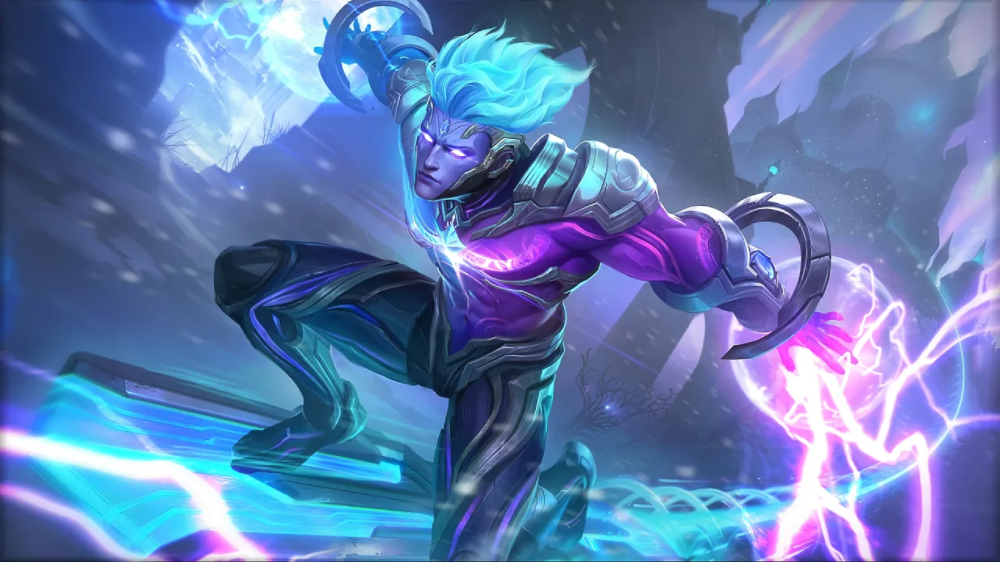
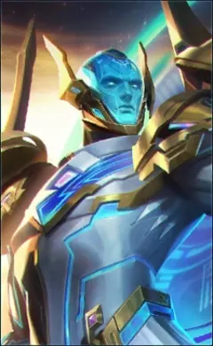

[Tier list](https://boostmlbb.ru/en/heroes/)[Items](https://boostmlbb.ru/en/items/)[Skins](https://boostmlbb.ru/en/skins/)[News & guides](https://boostmlbb.ru/en/news/)

[Skins](https://boostmlbb.ru/en/skins/)/Gord

# Gord skins

Skins

7

In the shop

3

Latest

[Imperator Vitalis](https://boostmlbb.ru/en/skins/gord/imperator-vitalis.html)2025

[Hero profile→](https://boostmlbb.ru/en/heroes/gord.html)

## All skins

AllSupremeExquisiteDeluxeExceptionalCommon

[Imperator VitalisExceptional · 2025](https://boostmlbb.ru/en/skins/gord/imperator-vitalis.html)[Cyber HackerDeluxe · 2024](https://boostmlbb.ru/en/skins/gord/cyber-hacker.html)[New BaronCommon · 2021](https://boostmlbb.ru/en/skins/gord/new-baron.html)[No.1 ControllerExquisite · 2019](https://boostmlbb.ru/en/skins/gord/no-1-controller.html)[ConquerorSupreme · 2018](https://boostmlbb.ru/en/skins/gord/conqueror.html)[Christmas CarnivalExceptional · 2016](https://boostmlbb.ru/en/skins/gord/christmas-carnival.html)[Professor of HellCommon · 2016](https://boostmlbb.ru/en/skins/gord/professor-of-hell.html)

**Rank up on Gord**The calculator shows the price

[Calculate price](https://boostmlbb.ru/en/order.html?type=hero)

## Frequently asked questions

How many skins does Gord have?

7 skins, the default look not counted. The newest is Imperator Vitalis (1 June 2025).

Which Gord skins can you buy now?

Cyber Hacker (899 diamonds), Professor of Hell (269 diamonds). The other skins were limited and come back only in events.

What is the rarest Gord skin?

Conqueror, Supreme class, Legend series. Exchanged for 200 Magic Crystals from the Magic Wheel.
