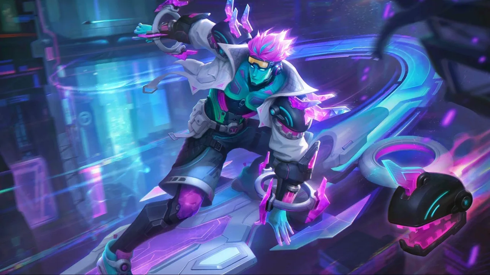

[Gord skins](https://boostmlbb.ru/en/skins/gord.html)

[Skins](https://boostmlbb.ru/en/skins/)/[Gord](https://boostmlbb.ru/en/skins/gord.html)/Cyber Hacker

[Gord skin](https://boostmlbb.ru/en/skins/gord.html)

# Cyber Hacker

DeluxeEpicIn the shop

How to get

Sold in the skin shop for 899 diamonds.

Price

899 diamonds

Released

21 August 2024

## What the skin changes

-   New look
-   New skill effects
-   Skill sounds
-   Showcase animation
-   Showcase scene
-   Showcase music
-   Attribute bonus

## All Gord skins [7](https://boostmlbb.ru/en/skins/gord.html)

[Imperator VitalisExceptional · 2025](https://boostmlbb.ru/en/skins/gord/imperator-vitalis.html)[Cyber HackerDeluxe · 2024](https://boostmlbb.ru/en/skins/gord/cyber-hacker.html)[New BaronCommon · 2021](https://boostmlbb.ru/en/skins/gord/new-baron.html)[No.1 ControllerExquisite · 2019](https://boostmlbb.ru/en/skins/gord/no-1-controller.html)[ConquerorSupreme · 2018](https://boostmlbb.ru/en/skins/gord/conqueror.html)[Christmas CarnivalExceptional · 2016](https://boostmlbb.ru/en/skins/gord/christmas-carnival.html)[Professor of HellCommon · 2016](https://boostmlbb.ru/en/skins/gord/professor-of-hell.html)

## Epic series

[Nether OverseerMinotaur · 2026](https://boostmlbb.ru/en/skins/minotaur/nether-overseer.html)[Sunken CurseAtlas · 2026](https://boostmlbb.ru/en/skins/atlas/sunken-curse.html)[Eternal VowVexana · 2026](https://boostmlbb.ru/en/skins/vexana/eternal-vow.html)[Cursed ScrollKhufra · 2025](https://boostmlbb.ru/en/skins/khufra/cursed-scroll.html)[Soul HuntressNatalia · 2025](https://boostmlbb.ru/en/skins/natalia/soul-huntress.html)[Nightmare CountLeomord · 2025](https://boostmlbb.ru/en/skins/leomord/nightmare-count.html)[Arbiter of StarsBelerick · 2025](https://boostmlbb.ru/en/skins/belerick/arbiter-of-stars.html)[Keeper of the WindsVale · 2025](https://boostmlbb.ru/en/skins/vale/keeper-of-the-winds.html)

**How much is a rank boost on Gord?**Choose your current and target ranks to see the price here.

[Calculate price](https://boostmlbb.ru/en/order.html?type=hero)

## Frequently asked questions

How to get the Cyber Hacker skin for Gord?

Sold in the skin shop for 899 diamonds.

When was Cyber Hacker released?

21 August 2024.

What class is Cyber Hacker?

Deluxe, Epic series.
