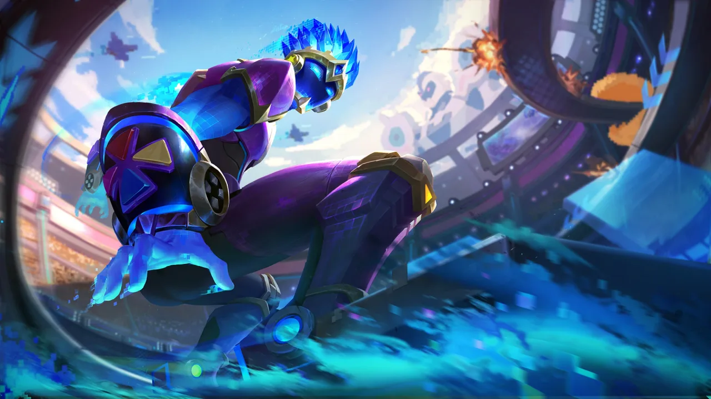
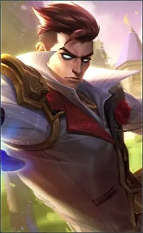
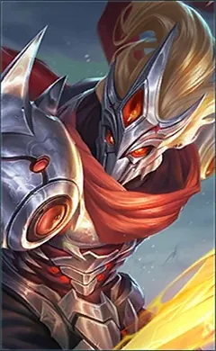

[Gord skins](https://boostmlbb.ru/en/skins/gord.html)

[Skins](https://boostmlbb.ru/en/skins/)/[Gord](https://boostmlbb.ru/en/skins/gord.html)/No.1 Controller

[Gord skin](https://boostmlbb.ru/en/skins/gord.html)

# No.1 Controller

ExquisiteAnnual StarLightLimited

How to get

StarLight Fest 2019 event.

Released

2019

## What the skin changes

-   New look
-   New skill effects
-   Skill sounds
-   Voice-over
-   Showcase animation
-   Showcase scene
-   Attribute bonus

## All Gord skins [7](https://boostmlbb.ru/en/skins/gord.html)

[Imperator VitalisExceptional · 2025](https://boostmlbb.ru/en/skins/gord/imperator-vitalis.html)[Cyber HackerDeluxe · 2024](https://boostmlbb.ru/en/skins/gord/cyber-hacker.html)[New BaronCommon · 2021](https://boostmlbb.ru/en/skins/gord/new-baron.html)[No.1 ControllerExquisite · 2019](https://boostmlbb.ru/en/skins/gord/no-1-controller.html)[ConquerorSupreme · 2018](https://boostmlbb.ru/en/skins/gord/conqueror.html)[Christmas CarnivalExceptional · 2016](https://boostmlbb.ru/en/skins/gord/christmas-carnival.html)[Professor of HellCommon · 2016](https://boostmlbb.ru/en/skins/gord/professor-of-hell.html)

## Annual StarLight series

[Concerto of LightVale · 2024](https://boostmlbb.ru/en/skins/vale/concerto-of-light.html)[Avatar of TimeAngela · 2023](https://boostmlbb.ru/en/skins/angela/avatar-of-time.html)[Hawk-eyed SniperLesley · 2021](https://boostmlbb.ru/en/skins/lesley/hawk-eyed-sniper.html)[Water LilyKagura · 2021](https://boostmlbb.ru/en/skins/kagura/water-lily.html)[Neon LightwheelKarrie · 2020](https://boostmlbb.ru/en/skins/karrie/neon-lightwheel.html)[Experiment 21Hayabusa · 2018](https://boostmlbb.ru/en/skins/hayabusa/experiment-21.html)

**How much is a rank boost on Gord?**Choose your current and target ranks to see the price here.

[Calculate price](https://boostmlbb.ru/en/order.html?type=hero)

## Frequently asked questions

How to get the No.1 Controller skin for Gord?

StarLight Fest 2019 event.

When was No.1 Controller released?

2019.

What class is No.1 Controller?

Exquisite, Annual StarLight series.
