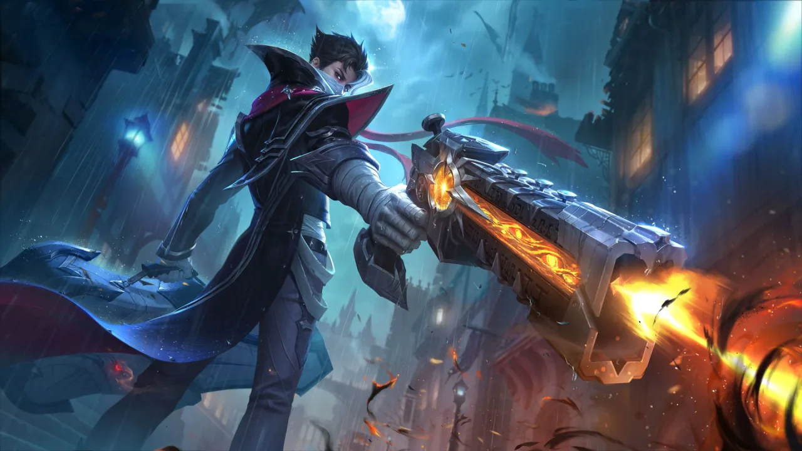
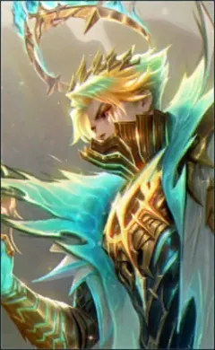

[All skins](https://boostmlbb.ru/en/skins/)

[Skins](https://boostmlbb.ru/en/skins/)/Granger

# Granger skins

Skins

12

In the shop

4

Latest

[Lightborn - Overrider](https://boostmlbb.ru/en/skins/granger/lightborn-overrider.html)2024

[Hero profile→](https://boostmlbb.ru/en/heroes/granger.html)

## All skins

AllSupremeGrandExquisiteDeluxeExceptionalCommon

[Lightborn - OverriderDeluxe · 2024](https://boostmlbb.ru/en/skins/granger/lightborn-overrider.html)[Alluring EnigmaDeluxe · 2024](https://boostmlbb.ru/en/skins/granger/alluring-enigma.html)[Exorcist GrangerGrand · 2023](https://boostmlbb.ru/en/skins/granger/exorcist-granger.html)[HellbringerExceptional · 2023](https://boostmlbb.ru/en/skins/granger/hellbringer.html)[MegatronGrand · 2023](https://boostmlbb.ru/en/skins/granger/megatron.html)[Starfall KnightSupreme · 2021](https://boostmlbb.ru/en/skins/granger/starfall-knight.html)[Agent ZExquisite · 2020](https://boostmlbb.ru/en/skins/granger/agent-z.html)[BiosoldierExceptional · 2020](https://boostmlbb.ru/en/skins/granger/biosoldier.html)[Doomsday TerminatorCommon · 2019](https://boostmlbb.ru/en/skins/granger/doomsday-terminator.html)[Bardic WhisperCommon · 2019](https://boostmlbb.ru/en/skins/granger/bardic-whisper.html)[Cosmic Finality](https://boostmlbb.ru/en/skins/granger/cosmic-finality.html)[Thunder Ascendant](https://boostmlbb.ru/en/skins/granger/thunder-ascendant.html)

**How much is a rank boost on Granger?**Choose your current and target ranks to see the price here.

[Calculate price](https://boostmlbb.ru/en/order.html?type=hero)

## Frequently asked questions

How many skins does Granger have?

12 skins, the default look not counted. The newest is Lightborn - Overrider (16 March 2024).

Which Granger skins can you buy now?

Lightborn - Overrider (1,080 diamonds), Hellbringer (749 diamonds), Doomsday Terminator (599 diamonds), Bardic Whisper (269 diamonds). The other skins were limited and come back only in events.

What is the rarest Granger skin?

Starfall Knight, Supreme class, Legend series. Exchanged for Magic Crystals from the Magic Wheel. Limited skins come back in event draws from time to time.
