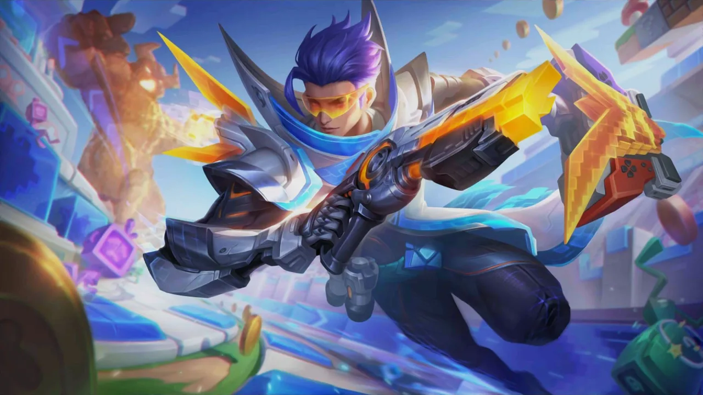

[Tier list](https://boostmlbb.ru/en/heroes/)[Items](https://boostmlbb.ru/en/items/)[Skins](https://boostmlbb.ru/en/skins/)[News & guides](https://boostmlbb.ru/en/news/)

[Skins](https://boostmlbb.ru/en/skins/)/[Granger](https://boostmlbb.ru/en/skins/granger.html)/Agent Z

[Granger skin](https://boostmlbb.ru/en/skins/granger.html)

# Agent Z

ExquisiteCollectorLimited

How to get

The top prize of a Collector event draw, paid with diamonds. Limited skins come back in event draws from time to time.

Released

5 October 2020

## What the skin changes

-   New look
-   New skill effects
-   Skill sounds
-   Showcase animation
-   Showcase scene
-   Attribute bonus

## All Granger skins [12](https://boostmlbb.ru/en/skins/granger.html)

[Lightborn - OverriderDeluxe · 2024](https://boostmlbb.ru/en/skins/granger/lightborn-overrider.html)[Alluring EnigmaDeluxe · 2024](https://boostmlbb.ru/en/skins/granger/alluring-enigma.html)[Exorcist GrangerGrand · 2023](https://boostmlbb.ru/en/skins/granger/exorcist-granger.html)[HellbringerExceptional · 2023](https://boostmlbb.ru/en/skins/granger/hellbringer.html)[MegatronGrand · 2023](https://boostmlbb.ru/en/skins/granger/megatron.html)[Starfall KnightSupreme · 2021](https://boostmlbb.ru/en/skins/granger/starfall-knight.html)[Agent ZExquisite · 2020](https://boostmlbb.ru/en/skins/granger/agent-z.html)[BiosoldierExceptional · 2020](https://boostmlbb.ru/en/skins/granger/biosoldier.html)[Doomsday TerminatorCommon · 2019](https://boostmlbb.ru/en/skins/granger/doomsday-terminator.html)[Bardic WhisperCommon · 2019](https://boostmlbb.ru/en/skins/granger/bardic-whisper.html)[Cosmic Finality](https://boostmlbb.ru/en/skins/granger/cosmic-finality.html)[Thunder Ascendant](https://boostmlbb.ru/en/skins/granger/thunder-ascendant.html)

## Collector series

[The PurifierBruno · 2026](https://boostmlbb.ru/en/skins/bruno/the-purifier.html)[Celestial RebelSun · 2026](https://boostmlbb.ru/en/skins/sun/celestial-rebel.html)[Kaiju of the DeepHelcurt · 2026](https://boostmlbb.ru/en/skins/helcurt/kaiju-of-the-deep.html)[Starbound SentryKimmy · 2026](https://boostmlbb.ru/en/skins/kimmy/starbound-sentry.html)[Dreaming MonarchAlice · 2026](https://boostmlbb.ru/en/skins/alice/dreaming-monarch.html)[Tremor of the DeepGrock · 2026](https://boostmlbb.ru/en/skins/grock/tremor-of-the-deep.html)[Celestial GeneralTigreal · 2026](https://boostmlbb.ru/en/skins/tigreal/celestial-general.html)[Sunborn MonarchXavier · 2026](https://boostmlbb.ru/en/skins/xavier/sunborn-monarch.html)

**Rank up on Granger**The calculator shows the price

[Calculate price](https://boostmlbb.ru/en/order.html?type=hero)

## Frequently asked questions

How to get the Agent Z skin for Granger?

The top prize of a Collector event draw, paid with diamonds. Limited skins come back in event draws from time to time.

When was Agent Z released?

5 October 2020.

What class is Agent Z?

Exquisite, Collector series.
