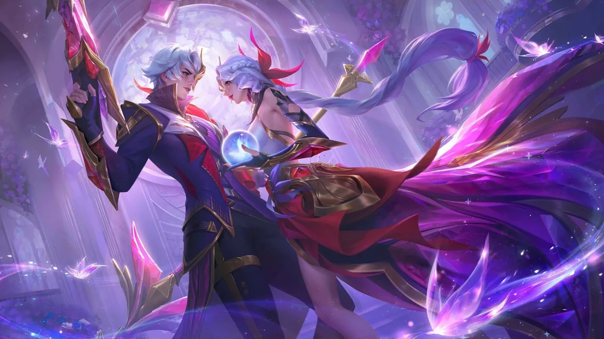
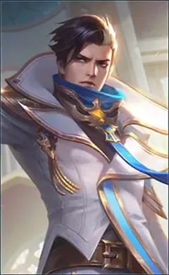

[Tier list](https://boostmlbb.ru/en/heroes/)[Items](https://boostmlbb.ru/en/items/)[Skins](https://boostmlbb.ru/en/skins/)[News & guides](https://boostmlbb.ru/en/news/)

[Skins](https://boostmlbb.ru/en/skins/)/[Granger](https://boostmlbb.ru/en/skins/granger.html)/Alluring Enigma

[Granger skin](https://boostmlbb.ru/en/skins/granger.html)

# Alluring Enigma

DeluxeValentineLimited

How to get

Released in the skin shop during an event. Limited skins come back in event draws from time to time.

Released

13 February 2024

## What the skin changes

-   New look
-   New skill effects
-   Skill sounds
-   Showcase animation
-   Showcase scene
-   Showcase music
-   Attribute bonus

## All Granger skins [12](https://boostmlbb.ru/en/skins/granger.html)

[Lightborn - OverriderDeluxe · 2024](https://boostmlbb.ru/en/skins/granger/lightborn-overrider.html)[Alluring EnigmaDeluxe · 2024](https://boostmlbb.ru/en/skins/granger/alluring-enigma.html)[Exorcist GrangerGrand · 2023](https://boostmlbb.ru/en/skins/granger/exorcist-granger.html)[HellbringerExceptional · 2023](https://boostmlbb.ru/en/skins/granger/hellbringer.html)[MegatronGrand · 2023](https://boostmlbb.ru/en/skins/granger/megatron.html)[Starfall KnightSupreme · 2021](https://boostmlbb.ru/en/skins/granger/starfall-knight.html)[Agent ZExquisite · 2020](https://boostmlbb.ru/en/skins/granger/agent-z.html)[BiosoldierExceptional · 2020](https://boostmlbb.ru/en/skins/granger/biosoldier.html)[Doomsday TerminatorCommon · 2019](https://boostmlbb.ru/en/skins/granger/doomsday-terminator.html)[Bardic WhisperCommon · 2019](https://boostmlbb.ru/en/skins/granger/bardic-whisper.html)[Cosmic Finality](https://boostmlbb.ru/en/skins/granger/cosmic-finality.html)[Thunder Ascendant](https://boostmlbb.ru/en/skins/granger/thunder-ascendant.html)

## Valentine series

[Heart AflameClaude · 2024](https://boostmlbb.ru/en/skins/claude/heart-aflame.html)[Alluring MystiqueSilvanna · 2024](https://boostmlbb.ru/en/skins/silvanna/alluring-mystique.html)[Gentleman ThiefKhufra · 2023](https://boostmlbb.ru/en/skins/khufra/gentleman-thief.html)[Heart AfloatFanny · 2022](https://boostmlbb.ru/en/skins/fanny/heart-afloat.html)[Phantom CountessCarmilla · 2021](https://boostmlbb.ru/en/skins/carmilla/phantom-countess.html)[Phantom CountCecilion · 2021](https://boostmlbb.ru/en/skins/cecilion/phantom-count.html)[Lady ThiefEsmeralda · 2020](https://boostmlbb.ru/en/skins/esmeralda/lady-thief.html)[Dangerous LoveLesley · 2019](https://boostmlbb.ru/en/skins/lesley/dangerous-love.html)

**Rank up on Granger**The calculator shows the price

[Calculate price](https://boostmlbb.ru/en/order.html?type=hero)

## Frequently asked questions

How to get the Alluring Enigma skin for Granger?

Released in the skin shop during an event. Limited skins come back in event draws from time to time.

When was Alluring Enigma released?

13 February 2024.

What class is Alluring Enigma?

Deluxe, Valentine series.
