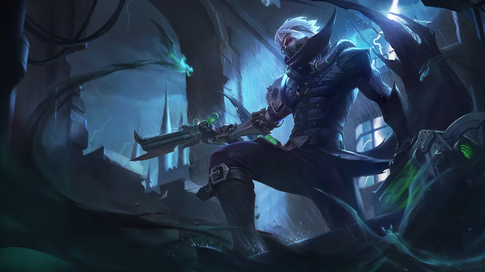
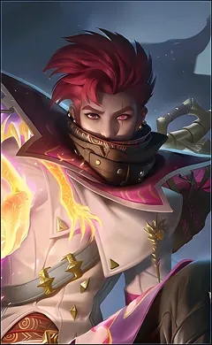

[Granger skins](https://boostmlbb.ru/en/skins/granger.html)

[Skins](https://boostmlbb.ru/en/skins/)/[Granger](https://boostmlbb.ru/en/skins/granger.html)/Biosoldier

[Granger skin](https://boostmlbb.ru/en/skins/granger.html)

# Biosoldier

ExceptionalStarLightLimited

How to get

StarLight reward for May 2020.

Released

1 May 2020

## What the skin changes

-   New look
-   New skill effects
-   Showcase animation
-   Attribute bonus

## All Granger skins [12](https://boostmlbb.ru/en/skins/granger.html)

[Lightborn - OverriderDeluxe · 2024](https://boostmlbb.ru/en/skins/granger/lightborn-overrider.html)[Alluring EnigmaDeluxe · 2024](https://boostmlbb.ru/en/skins/granger/alluring-enigma.html)[Exorcist GrangerGrand · 2023](https://boostmlbb.ru/en/skins/granger/exorcist-granger.html)[HellbringerExceptional · 2023](https://boostmlbb.ru/en/skins/granger/hellbringer.html)[MegatronGrand · 2023](https://boostmlbb.ru/en/skins/granger/megatron.html)[Starfall KnightSupreme · 2021](https://boostmlbb.ru/en/skins/granger/starfall-knight.html)[Agent ZExquisite · 2020](https://boostmlbb.ru/en/skins/granger/agent-z.html)[BiosoldierExceptional · 2020](https://boostmlbb.ru/en/skins/granger/biosoldier.html)[Doomsday TerminatorCommon · 2019](https://boostmlbb.ru/en/skins/granger/doomsday-terminator.html)[Bardic WhisperCommon · 2019](https://boostmlbb.ru/en/skins/granger/bardic-whisper.html)[Cosmic Finality](https://boostmlbb.ru/en/skins/granger/cosmic-finality.html)[Thunder Ascendant](https://boostmlbb.ru/en/skins/granger/thunder-ascendant.html)

## StarLight series

[Tideborn SailorKalea · 2026](https://boostmlbb.ru/en/skins/kalea/tideborn-sailor.html)[Kitsune's ShadowHayabusa · 2026](https://boostmlbb.ru/en/skins/hayabusa/kitsune-s-shadow.html)[Fangs of SlaughterHanzo · 2026](https://boostmlbb.ru/en/skins/hanzo/fangs-of-slaughter.html)[Smoul­dering FortressBelerick · 2026](https://boostmlbb.ru/en/skins/belerick/smouldering-fortress.html)[Magitech WraithObsidia · 2026](https://boostmlbb.ru/en/skins/obsidia/magitech-wraith.html)[Elysian LuminanceZetian · 2026](https://boostmlbb.ru/en/skins/zetian/elysian-luminance.html)[Guardian BattalionHilda · 2026](https://boostmlbb.ru/en/skins/hilda/guardian-battalion.html)[Dreaming KoiHarley · 2026](https://boostmlbb.ru/en/skins/harley/dreaming-koi.html)

**How much is a rank boost on Granger?**Choose your current and target ranks to see the price here.

[Calculate price](https://boostmlbb.ru/en/order.html?type=hero)

## Frequently asked questions

How to get the Biosoldier skin for Granger?

StarLight reward for May 2020.

When was Biosoldier released?

1 May 2020.

What class is Biosoldier?

Exceptional, StarLight series.
