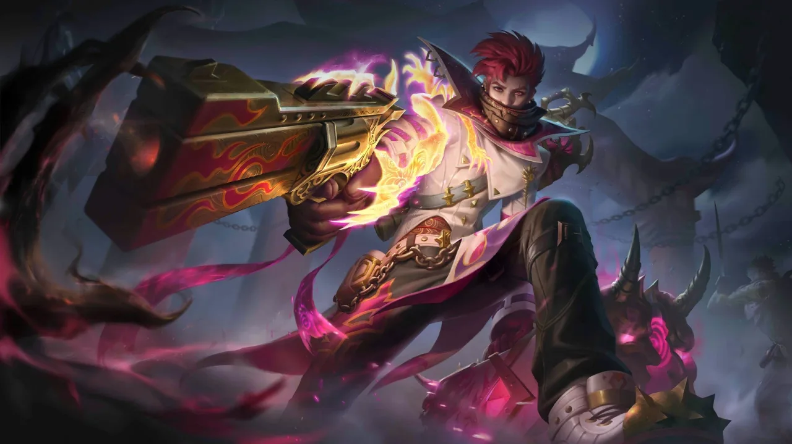

[Tier list](https://boostmlbb.ru/en/heroes/)[Items](https://boostmlbb.ru/en/items/)[Skins](https://boostmlbb.ru/en/skins/)[News & guides](https://boostmlbb.ru/en/news/)

[Skins](https://boostmlbb.ru/en/skins/)/[Granger](https://boostmlbb.ru/en/skins/granger.html)/Exorcist Granger

[Granger skin](https://boostmlbb.ru/en/skins/granger.html)

# Exorcist Granger

GrandThe ExorcistsLimited

How to get

Released in the The Exorcists event. Limited skins come back in event draws from time to time.

Released

18 February 2023

## What the skin changes

-   New look
-   New skill effects
-   Skill sounds
-   Voice-over
-   Skill icons
-   Showcase animation
-   Showcase scene
-   Showcase music
-   Spawn animation
-   Special actions
-   Attribute bonus

## All Granger skins [12](https://boostmlbb.ru/en/skins/granger.html)

[Lightborn - OverriderDeluxe · 2024](https://boostmlbb.ru/en/skins/granger/lightborn-overrider.html)[Alluring EnigmaDeluxe · 2024](https://boostmlbb.ru/en/skins/granger/alluring-enigma.html)[Exorcist GrangerGrand · 2023](https://boostmlbb.ru/en/skins/granger/exorcist-granger.html)[HellbringerExceptional · 2023](https://boostmlbb.ru/en/skins/granger/hellbringer.html)[MegatronGrand · 2023](https://boostmlbb.ru/en/skins/granger/megatron.html)[Starfall KnightSupreme · 2021](https://boostmlbb.ru/en/skins/granger/starfall-knight.html)[Agent ZExquisite · 2020](https://boostmlbb.ru/en/skins/granger/agent-z.html)[BiosoldierExceptional · 2020](https://boostmlbb.ru/en/skins/granger/biosoldier.html)[Doomsday TerminatorCommon · 2019](https://boostmlbb.ru/en/skins/granger/doomsday-terminator.html)[Bardic WhisperCommon · 2019](https://boostmlbb.ru/en/skins/granger/bardic-whisper.html)[Cosmic Finality](https://boostmlbb.ru/en/skins/granger/cosmic-finality.html)[Thunder Ascendant](https://boostmlbb.ru/en/skins/granger/thunder-ascendant.html)

## The Exorcists series

[Exorcist HayabusaHayabusa · 2024](https://boostmlbb.ru/en/skins/hayabusa/exorcist-hayabusa.html)[Exorcist Yu ZhongYu Zhong · 2022](https://boostmlbb.ru/en/skins/yu-zhong/exorcist-yu-zhong.html)[Exorcist KaguraKagura · 2022](https://boostmlbb.ru/en/skins/kagura/exorcist-kagura.html)

**Rank up on Granger**The calculator shows the price

[Calculate price](https://boostmlbb.ru/en/order.html?type=hero)

## Frequently asked questions

How to get the Exorcist Granger skin for Granger?

Released in the The Exorcists event. Limited skins come back in event draws from time to time.

When was Exorcist Granger released?

18 February 2023.

What class is Exorcist Granger?

Grand, The Exorcists series.
