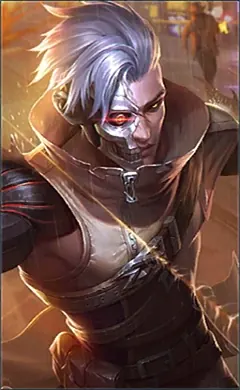

[Tier list](https://boostmlbb.ru/en/heroes/)[Items](https://boostmlbb.ru/en/items/)[Skins](https://boostmlbb.ru/en/skins/)[News & guides](https://boostmlbb.ru/en/news/)

[Skins](https://boostmlbb.ru/en/skins/)/[Granger](https://boostmlbb.ru/en/skins/granger.html)/Megatron

[Granger skin](https://boostmlbb.ru/en/skins/granger.html)

# Megatron

GrandTransformersLimited

How to get

Released in the MLBB × Transformers event.

Released

18 February 2023

## What the skin changes

-   New look
-   New skill effects
-   Skill sounds
-   Voice-over
-   Skill icons
-   Showcase animation
-   Showcase scene
-   Attribute bonus

## All Granger skins [12](https://boostmlbb.ru/en/skins/granger.html)

[Lightborn - OverriderDeluxe · 2024](https://boostmlbb.ru/en/skins/granger/lightborn-overrider.html)[Alluring EnigmaDeluxe · 2024](https://boostmlbb.ru/en/skins/granger/alluring-enigma.html)[Exorcist GrangerGrand · 2023](https://boostmlbb.ru/en/skins/granger/exorcist-granger.html)[HellbringerExceptional · 2023](https://boostmlbb.ru/en/skins/granger/hellbringer.html)[MegatronGrand · 2023](https://boostmlbb.ru/en/skins/granger/megatron.html)[Starfall KnightSupreme · 2021](https://boostmlbb.ru/en/skins/granger/starfall-knight.html)[Agent ZExquisite · 2020](https://boostmlbb.ru/en/skins/granger/agent-z.html)[BiosoldierExceptional · 2020](https://boostmlbb.ru/en/skins/granger/biosoldier.html)[Doomsday TerminatorCommon · 2019](https://boostmlbb.ru/en/skins/granger/doomsday-terminator.html)[Bardic WhisperCommon · 2019](https://boostmlbb.ru/en/skins/granger/bardic-whisper.html)[Cosmic Finality](https://boostmlbb.ru/en/skins/granger/cosmic-finality.html)[Thunder Ascendant](https://boostmlbb.ru/en/skins/granger/thunder-ascendant.html)

## Transformers series

[BumblebeeX.Borg · 2025](https://boostmlbb.ru/en/skins/x-borg/bumblebee.html)[Optimus PrimeJohnson · 2023](https://boostmlbb.ru/en/skins/johnson/optimus-prime.html)[Soundwave & RavagePopol and Kupa · 2022](https://boostmlbb.ru/en/skins/popol-and-kupa/soundwave-ravage.html)[StarscreamAldous · 2022](https://boostmlbb.ru/en/skins/aldous/starscream.html)[GrimlockRoger · 2022](https://boostmlbb.ru/en/skins/roger/grimlock.html)

**Rank up on Granger**The calculator shows the price

[Calculate price](https://boostmlbb.ru/en/order.html?type=hero)

## Frequently asked questions

How to get the Megatron skin for Granger?

Released in the MLBB × Transformers event.

When was Megatron released?

18 February 2023.

What class is Megatron?

Grand, Transformers series.
