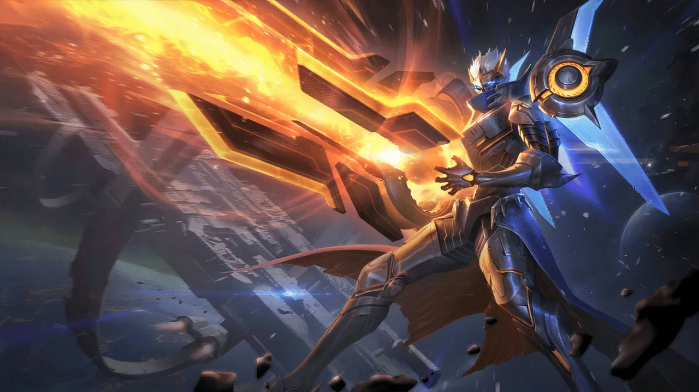

[Tier list](https://boostmlbb.ru/en/heroes/)[Items](https://boostmlbb.ru/en/items/)[Skins](https://boostmlbb.ru/en/skins/)[News & guides](https://boostmlbb.ru/en/news/)

[Skins](https://boostmlbb.ru/en/skins/)/[Granger](https://boostmlbb.ru/en/skins/granger.html)/Starfall Knight

[Granger skin](https://boostmlbb.ru/en/skins/granger.html)

# Starfall Knight

SupremeLegendLimited

How to get

Exchanged for Magic Crystals from the Magic Wheel. Limited skins come back in event draws from time to time.

Released

23 April 2021

## What the skin changes

-   New look
-   New skill effects
-   Skill animations
-   Skill sounds
-   Voice-over
-   Skill icons
-   Showcase animation
-   Showcase scene
-   Recall effect
-   Avatar border
-   Achievement
-   Attribute bonus

## All Granger skins [12](https://boostmlbb.ru/en/skins/granger.html)

[Lightborn - OverriderDeluxe · 2024](https://boostmlbb.ru/en/skins/granger/lightborn-overrider.html)[Alluring EnigmaDeluxe · 2024](https://boostmlbb.ru/en/skins/granger/alluring-enigma.html)[Exorcist GrangerGrand · 2023](https://boostmlbb.ru/en/skins/granger/exorcist-granger.html)[HellbringerExceptional · 2023](https://boostmlbb.ru/en/skins/granger/hellbringer.html)[MegatronGrand · 2023](https://boostmlbb.ru/en/skins/granger/megatron.html)[Starfall KnightSupreme · 2021](https://boostmlbb.ru/en/skins/granger/starfall-knight.html)[Agent ZExquisite · 2020](https://boostmlbb.ru/en/skins/granger/agent-z.html)[BiosoldierExceptional · 2020](https://boostmlbb.ru/en/skins/granger/biosoldier.html)[Doomsday TerminatorCommon · 2019](https://boostmlbb.ru/en/skins/granger/doomsday-terminator.html)[Bardic WhisperCommon · 2019](https://boostmlbb.ru/en/skins/granger/bardic-whisper.html)[Cosmic Finality](https://boostmlbb.ru/en/skins/granger/cosmic-finality.html)[Thunder Ascendant](https://boostmlbb.ru/en/skins/granger/thunder-ascendant.html)

## Legend series

[Revenant of RosesAlpha · 2025](https://boostmlbb.ru/en/skins/alpha/revenant-of-roses.html)[Sovereign of RealmsJohnson · 2025](https://boostmlbb.ru/en/skins/johnson/sovereign-of-realms.html)[Galactic VanquisherFreya · 2024](https://boostmlbb.ru/en/skins/freya/galactic-vanquisher.html)[Divine GoddessLunox · 2023](https://boostmlbb.ru/en/skins/lunox/divine-goddess.html)[King of HellFranco · 2023](https://boostmlbb.ru/en/skins/franco/king-of-hell.html)[Psion of TomorrowGuinevere · 2022](https://boostmlbb.ru/en/skins/guinevere/psion-of-tomorrow.html)[Infernal BlazeValir · 2022](https://boostmlbb.ru/en/skins/valir/infernal-blaze.html)[Cosmic GleamGusion · 2022](https://boostmlbb.ru/en/skins/gusion/cosmic-gleam.html)

**Rank up on Granger**The calculator shows the price

[Calculate price](https://boostmlbb.ru/en/order.html?type=hero)

## Frequently asked questions

How to get the Starfall Knight skin for Granger?

Exchanged for Magic Crystals from the Magic Wheel. Limited skins come back in event draws from time to time.

When was Starfall Knight released?

23 April 2021.

What class is Starfall Knight?

Supreme, Legend series.
