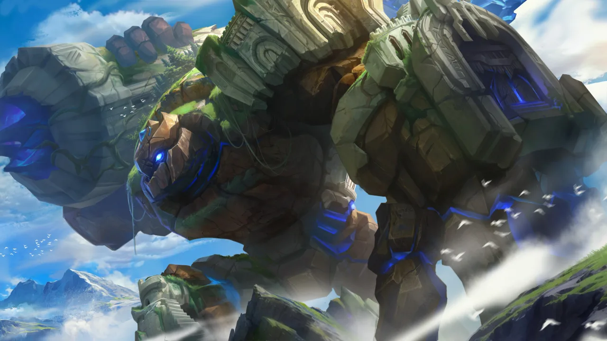

[All skins](https://boostmlbb.ru/en/skins/)

[Skins](https://boostmlbb.ru/en/skins/)/Grock

# Grock skins

Skins

8

In the shop

4

Latest

[Tremor of the Deep](https://boostmlbb.ru/en/skins/grock/tremor-of-the-deep.html)2026

[Hero profile→](https://boostmlbb.ru/en/heroes/grock.html)

## All skins

AllDeluxeExceptionalCommon

[Tremor of the Deep2026](https://boostmlbb.ru/en/skins/grock/tremor-of-the-deep.html)[Codename: RhinoDeluxe · 2020](https://boostmlbb.ru/en/skins/grock/codename-rhino.html)[Ancient GolemCommon · 2019](https://boostmlbb.ru/en/skins/grock/ancient-golem.html)[V.E.N.O.M. Monitor LizardDeluxe · 2019](https://boostmlbb.ru/en/skins/grock/v-e-n-o-m-monitor-lizard.html)[Iceland GolemExceptional · 2019](https://boostmlbb.ru/en/skins/grock/iceland-golem.html)[Wasteland PsychoExceptional · 2018](https://boostmlbb.ru/en/skins/grock/wasteland-psycho.html)[Castle GuardCommon · 2018](https://boostmlbb.ru/en/skins/grock/castle-guard.html)[Grave GuardianCommon · 2017](https://boostmlbb.ru/en/skins/grock/grave-guardian.html)

**How much is a rank boost on Grock?**Choose your current and target ranks to see the price here.

[Calculate price](https://boostmlbb.ru/en/order.html?type=hero)

## Frequently asked questions

How many skins does Grock have?

8 skins, the default look not counted. The newest is Tremor of the Deep (April 2026).

Which Grock skins can you buy now?

Codename: Rhino (899 diamonds), V.E.N.O.M. Monitor Lizard (899 diamonds), Castle Guard (599 diamonds), Grave Guardian (269 diamonds). The other skins were limited and come back only in events.

What is the rarest Grock skin?

Codename: Rhino, Deluxe class, Epic series. Sold in the skin shop for 899 diamonds.
