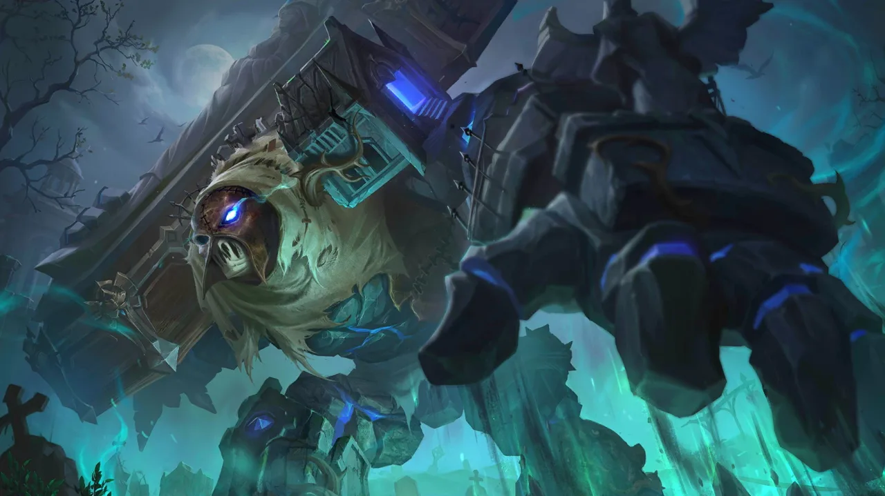

[Tier list](https://boostmlbb.ru/en/heroes/)[Items](https://boostmlbb.ru/en/items/)[Skins](https://boostmlbb.ru/en/skins/)[News & guides](https://boostmlbb.ru/en/news/)

[Skins](https://boostmlbb.ru/en/skins/)/[Grock](https://boostmlbb.ru/en/skins/grock.html)/Grave Guardian

[Grock skin](https://boostmlbb.ru/en/skins/grock.html)

# Grave Guardian

CommonIn the shop

How to get

Sold in the skin shop for 269 diamonds.

Price

269 diamonds

Released

29 September 2017

## What the skin changes

-   Attribute bonus

## All Grock skins [8](https://boostmlbb.ru/en/skins/grock.html)

[Tremor of the Deep2026](https://boostmlbb.ru/en/skins/grock/tremor-of-the-deep.html)[Codename: RhinoDeluxe · 2020](https://boostmlbb.ru/en/skins/grock/codename-rhino.html)[Ancient GolemCommon · 2019](https://boostmlbb.ru/en/skins/grock/ancient-golem.html)[V.E.N.O.M. Monitor LizardDeluxe · 2019](https://boostmlbb.ru/en/skins/grock/v-e-n-o-m-monitor-lizard.html)[Iceland GolemExceptional · 2019](https://boostmlbb.ru/en/skins/grock/iceland-golem.html)[Wasteland PsychoExceptional · 2018](https://boostmlbb.ru/en/skins/grock/wasteland-psycho.html)[Castle GuardCommon · 2018](https://boostmlbb.ru/en/skins/grock/castle-guard.html)[Grave GuardianCommon · 2017](https://boostmlbb.ru/en/skins/grock/grave-guardian.html)

**Rank up on Grock**The calculator shows the price

[Calculate price](https://boostmlbb.ru/en/order.html?type=hero)

## Frequently asked questions

How to get the Grave Guardian skin for Grock?

Sold in the skin shop for 269 diamonds.

When was Grave Guardian released?

29 September 2017.

What class is Grave Guardian?

Common.
