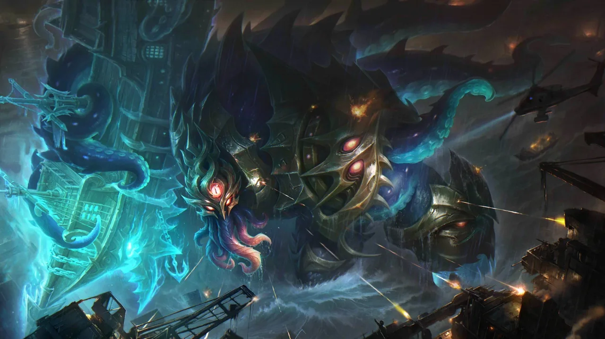

[Tier list](https://boostmlbb.ru/en/heroes/)[Items](https://boostmlbb.ru/en/items/)[Skins](https://boostmlbb.ru/en/skins/)[News & guides](https://boostmlbb.ru/en/news/)

[Skins](https://boostmlbb.ru/en/skins/)/[Grock](https://boostmlbb.ru/en/skins/grock.html)/Tremor of the Deep

[Grock skin](https://boostmlbb.ru/en/skins/grock.html)

# Tremor of the Deep

Collector

How to get

The top prize of a Collector event draw, paid with diamonds. Limited skins come back in event draws from time to time.

Released

April 2026

## All Grock skins [8](https://boostmlbb.ru/en/skins/grock.html)

[Tremor of the Deep2026](https://boostmlbb.ru/en/skins/grock/tremor-of-the-deep.html)[Codename: RhinoDeluxe · 2020](https://boostmlbb.ru/en/skins/grock/codename-rhino.html)[Ancient GolemCommon · 2019](https://boostmlbb.ru/en/skins/grock/ancient-golem.html)[V.E.N.O.M. Monitor LizardDeluxe · 2019](https://boostmlbb.ru/en/skins/grock/v-e-n-o-m-monitor-lizard.html)[Iceland GolemExceptional · 2019](https://boostmlbb.ru/en/skins/grock/iceland-golem.html)[Wasteland PsychoExceptional · 2018](https://boostmlbb.ru/en/skins/grock/wasteland-psycho.html)[Castle GuardCommon · 2018](https://boostmlbb.ru/en/skins/grock/castle-guard.html)[Grave GuardianCommon · 2017](https://boostmlbb.ru/en/skins/grock/grave-guardian.html)

## Collector series

[The PurifierBruno · 2026](https://boostmlbb.ru/en/skins/bruno/the-purifier.html)[Celestial RebelSun · 2026](https://boostmlbb.ru/en/skins/sun/celestial-rebel.html)[Kaiju of the DeepHelcurt · 2026](https://boostmlbb.ru/en/skins/helcurt/kaiju-of-the-deep.html)[Starbound SentryKimmy · 2026](https://boostmlbb.ru/en/skins/kimmy/starbound-sentry.html)[Dreaming MonarchAlice · 2026](https://boostmlbb.ru/en/skins/alice/dreaming-monarch.html)[Celestial GeneralTigreal · 2026](https://boostmlbb.ru/en/skins/tigreal/celestial-general.html)[Sunborn MonarchXavier · 2026](https://boostmlbb.ru/en/skins/xavier/sunborn-monarch.html)[Soul ReaverAamon · 2025](https://boostmlbb.ru/en/skins/aamon/soul-reaver.html)

**Rank up on Grock**The calculator shows the price

[Calculate price](https://boostmlbb.ru/en/order.html?type=hero)

## Frequently asked questions

How to get the Tremor of the Deep skin for Grock?

The top prize of a Collector event draw, paid with diamonds. Limited skins come back in event draws from time to time.

When was Tremor of the Deep released?

April 2026.
