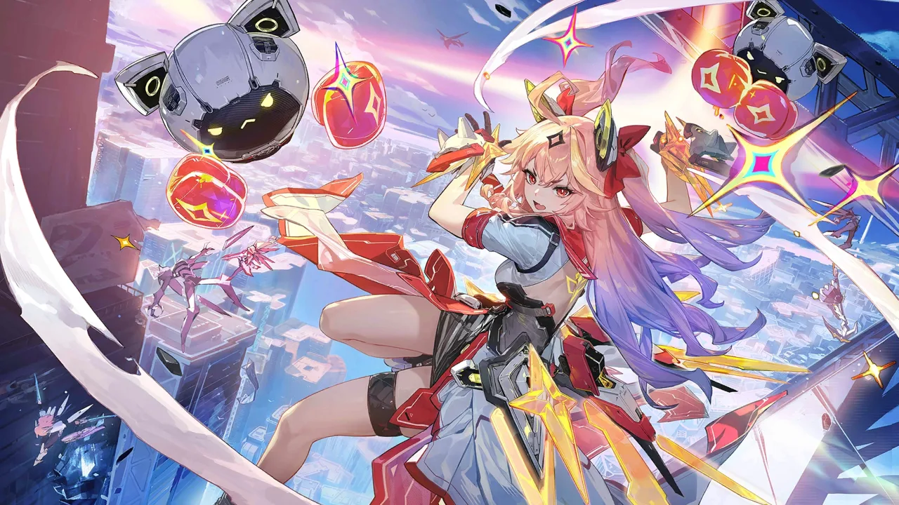

[Tier list](https://boostmlbb.ru/en/heroes/)[Items](https://boostmlbb.ru/en/items/)[Skins](https://boostmlbb.ru/en/skins/)[News & guides](https://boostmlbb.ru/en/news/)

[Skins](https://boostmlbb.ru/en/skins/)/[Guinevere](https://boostmlbb.ru/en/skins/guinevere.html)/Daybreak Halo

[Guinevere skin](https://boostmlbb.ru/en/skins/guinevere.html)

# Daybreak Halo

GrandThe AspirantsLimited

How to get

Released in the The Aspirants event. Limited skins come back in event draws from time to time.

Released

3 October 2025

## What the skin changes

-   New look
-   New skill effects
-   Skill sounds
-   Voice-over
-   Skill icons
-   Showcase animation
-   Showcase scene
-   Showcase music
-   Spawn animation
-   Special actions
-   Attribute bonus

## All Guinevere skins [10](https://boostmlbb.ru/en/skins/guinevere.html)

[Daybreak HaloGrand · 2025](https://boostmlbb.ru/en/skins/guinevere/daybreak-halo.html)[Lady CraneExquisite · 2025](https://boostmlbb.ru/en/skins/guinevere/lady-crane.html)[Elegant ButterflyCommon · 2024](https://boostmlbb.ru/en/skins/guinevere/elegant-butterfly.html)[Summer BreezeExceptional · 2024](https://boostmlbb.ru/en/skins/guinevere/summer-breeze.html)[Psion of TomorrowSupreme · 2022](https://boostmlbb.ru/en/skins/guinevere/psion-of-tomorrow.html)[Sakura WishesExceptional · 2020](https://boostmlbb.ru/en/skins/guinevere/sakura-wishes.html)[Amethyst DanceExceptional · 2020](https://boostmlbb.ru/en/skins/guinevere/amethyst-dance.html)[LotusExceptional · 2019](https://boostmlbb.ru/en/skins/guinevere/lotus.html)[Athena AsamiyaGrand · 2019](https://boostmlbb.ru/en/skins/guinevere/athena-asamiya.html)[Fleur de BleauCommon · 2019](https://boostmlbb.ru/en/skins/guinevere/fleur-de-bleau.html)

## The Aspirants series

[Silverbolt RaikoSelena · 2026](https://boostmlbb.ru/en/skins/selena/silverbolt-raiko.html)[Imperatrix ArashiObsidia · 2026](https://boostmlbb.ru/en/skins/obsidia/imperatrix-arashi.html)[Twilight StarVexana · 2025](https://boostmlbb.ru/en/skins/vexana/twilight-star.html)[Tech TensaiChang'e · 2024](https://boostmlbb.ru/en/skins/change/tech-tensai.html)[Deadeye SpectreLesley · 2024](https://boostmlbb.ru/en/skins/lesley/deadeye-spectre.html)[Mecha MaidenRuby · 2023](https://boostmlbb.ru/en/skins/ruby/mecha-maiden.html)[Blade of KibouFanny · 2022](https://boostmlbb.ru/en/skins/fanny/blade-of-kibou.html)[Miss HikariLayla · 2022](https://boostmlbb.ru/en/skins/layla/miss-hikari.html)

**Rank up on Guinevere**The calculator shows the price

[Calculate price](https://boostmlbb.ru/en/order.html?type=hero)

## Frequently asked questions

How to get the Daybreak Halo skin for Guinevere?

Released in the The Aspirants event. Limited skins come back in event draws from time to time.

When was Daybreak Halo released?

3 October 2025.

What class is Daybreak Halo?

Grand, The Aspirants series.
