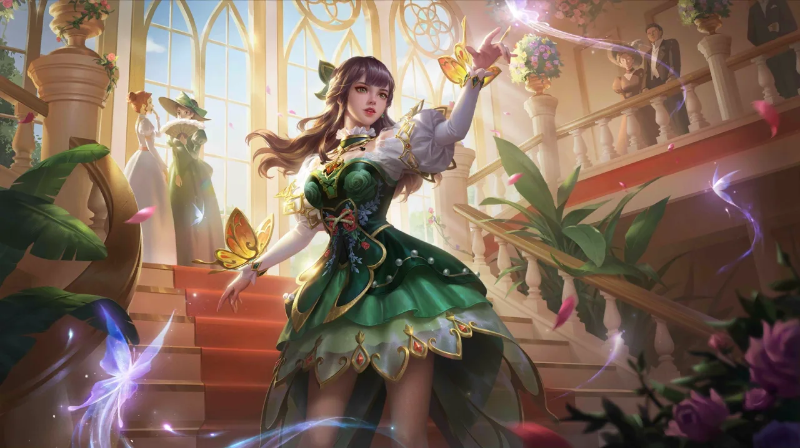

[Tier list](https://boostmlbb.ru/en/heroes/)[Items](https://boostmlbb.ru/en/items/)[Skins](https://boostmlbb.ru/en/skins/)[News & guides](https://boostmlbb.ru/en/news/)

[Skins](https://boostmlbb.ru/en/skins/)/[Guinevere](https://boostmlbb.ru/en/skins/guinevere.html)/Elegant Butterfly

[Guinevere skin](https://boostmlbb.ru/en/skins/guinevere.html)

# Elegant Butterfly

CommonEliteLimited

How to get

First top-up gift in Season 31.

Released

16 March 2024

## What the skin changes

-   New look
-   Recoloured effects
-   Showcase animation
-   Attribute bonus

## All Guinevere skins [10](https://boostmlbb.ru/en/skins/guinevere.html)

[Daybreak HaloGrand · 2025](https://boostmlbb.ru/en/skins/guinevere/daybreak-halo.html)[Lady CraneExquisite · 2025](https://boostmlbb.ru/en/skins/guinevere/lady-crane.html)[Elegant ButterflyCommon · 2024](https://boostmlbb.ru/en/skins/guinevere/elegant-butterfly.html)[Summer BreezeExceptional · 2024](https://boostmlbb.ru/en/skins/guinevere/summer-breeze.html)[Psion of TomorrowSupreme · 2022](https://boostmlbb.ru/en/skins/guinevere/psion-of-tomorrow.html)[Sakura WishesExceptional · 2020](https://boostmlbb.ru/en/skins/guinevere/sakura-wishes.html)[Amethyst DanceExceptional · 2020](https://boostmlbb.ru/en/skins/guinevere/amethyst-dance.html)[LotusExceptional · 2019](https://boostmlbb.ru/en/skins/guinevere/lotus.html)[Athena AsamiyaGrand · 2019](https://boostmlbb.ru/en/skins/guinevere/athena-asamiya.html)[Fleur de BleauCommon · 2019](https://boostmlbb.ru/en/skins/guinevere/fleur-de-bleau.html)

## Elite series

[Golden OsmanthusChang'e · 2026](https://boostmlbb.ru/en/skins/change/golden-osmanthus.html)[Warlord KingMartis · 2025](https://boostmlbb.ru/en/skins/martis/warlord-king.html)[High Seas CadetKimmy · 2024](https://boostmlbb.ru/en/skins/kimmy/high-seas-cadet.html)[Verdant LancerSilvanna · 2024](https://boostmlbb.ru/en/skins/silvanna/verdant-lancer.html)[Bloodhoof MarauderHylos · 2024](https://boostmlbb.ru/en/skins/hylos/bloodhoof-marauder.html)[Marques of BladesLancelot · 2024](https://boostmlbb.ru/en/skins/lancelot/marques-of-blades.html)[Badlands HiatusChip · 2024](https://boostmlbb.ru/en/skins/chip/badlands-hiatus.html)[Star MagicianHarley · 2024](https://boostmlbb.ru/en/skins/harley/star-magician.html)

**Rank up on Guinevere**The calculator shows the price

[Calculate price](https://boostmlbb.ru/en/order.html?type=hero)

## Frequently asked questions

How to get the Elegant Butterfly skin for Guinevere?

First top-up gift in Season 31.

When was Elegant Butterfly released?

16 March 2024.

What class is Elegant Butterfly?

Common, Elite series.
