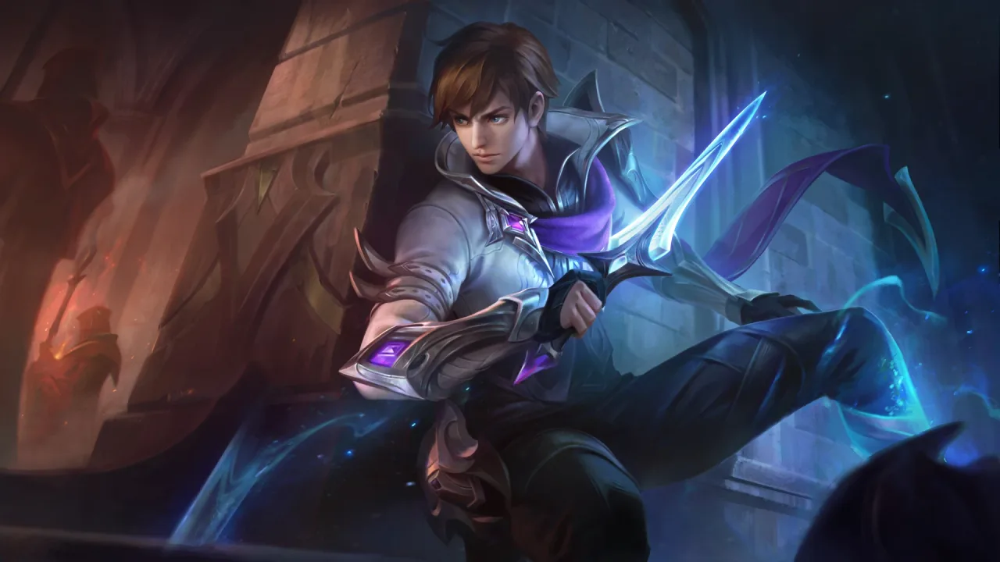

[Tier list](https://boostmlbb.ru/en/heroes/)[Items](https://boostmlbb.ru/en/items/)[Skins](https://boostmlbb.ru/en/skins/)[News & guides](https://boostmlbb.ru/en/news/)

[Skins](https://boostmlbb.ru/en/skins/)/Gusion

# Gusion skins

Skins

12

In the shop

6

Latest

[Desert Spider](https://boostmlbb.ru/en/skins/gusion/desert-spider.html)2024

[Hero profile→](https://boostmlbb.ru/en/heroes/gusion.html)

## All skins

AllSupremeGrandExquisiteDeluxeExceptionalCommon

[Desert SpiderExceptional · 2024](https://boostmlbb.ru/en/skins/gusion/desert-spider.html)[K'Grand · 2024](https://boostmlbb.ru/en/skins/gusion/k.html)[Dimension WalkerGrand · 2023](https://boostmlbb.ru/en/skins/gusion/dimension-walker.html)[Soul RevelationDeluxe · 2023](https://boostmlbb.ru/en/skins/gusion/soul-revelation.html)[Cosmic GleamSupreme · 2022](https://boostmlbb.ru/en/skins/gusion/cosmic-gleam.html)[Night OwlExquisite · 2021](https://boostmlbb.ru/en/skins/gusion/night-owl.html)[V.E.N.O.M. Emperor ScorpionDeluxe · 2019](https://boostmlbb.ru/en/skins/gusion/v-e-n-o-m-emperor-scorpion.html)[Dangerous LiaisonExceptional · 2019](https://boostmlbb.ru/en/skins/gusion/dangerous-liaison.html)[Cyber OpsExceptional · 2018](https://boostmlbb.ru/en/skins/gusion/cyber-ops.html)[Hairsty­listCommon · 2018](https://boostmlbb.ru/en/skins/gusion/hairstylist.html)[Moonlight SonataCommon · 2018](https://boostmlbb.ru/en/skins/gusion/moonlight-sonata.html)[Minato Namikaze](https://boostmlbb.ru/en/skins/gusion/minato-namikaze.html)

**Rank up on Gusion**The calculator shows the price

[Calculate price](https://boostmlbb.ru/en/order.html?type=hero)

## Frequently asked questions

How many skins does Gusion have?

12 skins, the default look not counted. The newest is Desert Spider (1 July 2024).

Which Gusion skins can you buy now?

Soul Revelation (899 diamonds), V.E.N.O.M. Emperor Scorpion (899 diamonds), Dangerous Liaison (749 diamonds), Hairstylist (599 diamonds), Moonlight Sonata (269 diamonds). The other skins were limited and come back only in events.

What is the rarest Gusion skin?

Cosmic Gleam, Supreme class, Legend series. Exchanged for 200 Magic Crystals from the Magic Wheel.
