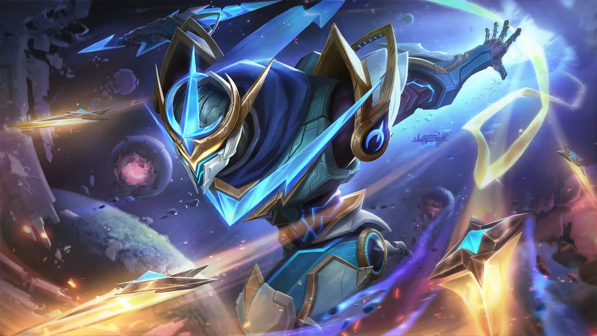

[Tier list](https://boostmlbb.ru/en/heroes/)[Items](https://boostmlbb.ru/en/items/)[Skins](https://boostmlbb.ru/en/skins/)[News & guides](https://boostmlbb.ru/en/news/)

[Skins](https://boostmlbb.ru/en/skins/)/[Gusion](https://boostmlbb.ru/en/skins/gusion.html)/Cosmic Gleam

[Gusion skin](https://boostmlbb.ru/en/skins/gusion.html)

# Cosmic Gleam

SupremeLegendIn the shop

How to get

Exchanged for 200 Magic Crystals from the Magic Wheel.

Price

200 Magic Crystals

Released

6 January 2022

## What the skin changes

-   New look
-   New skill effects
-   Skill animations
-   Skill sounds
-   Voice-over
-   Skill icons
-   Showcase animation
-   Showcase scene
-   Recall effect
-   Avatar border
-   Achievement
-   Attribute bonus

## All Gusion skins [12](https://boostmlbb.ru/en/skins/gusion.html)

[Desert SpiderExceptional · 2024](https://boostmlbb.ru/en/skins/gusion/desert-spider.html)[K'Grand · 2024](https://boostmlbb.ru/en/skins/gusion/k.html)[Dimension WalkerGrand · 2023](https://boostmlbb.ru/en/skins/gusion/dimension-walker.html)[Soul RevelationDeluxe · 2023](https://boostmlbb.ru/en/skins/gusion/soul-revelation.html)[Cosmic GleamSupreme · 2022](https://boostmlbb.ru/en/skins/gusion/cosmic-gleam.html)[Night OwlExquisite · 2021](https://boostmlbb.ru/en/skins/gusion/night-owl.html)[V.E.N.O.M. Emperor ScorpionDeluxe · 2019](https://boostmlbb.ru/en/skins/gusion/v-e-n-o-m-emperor-scorpion.html)[Dangerous LiaisonExceptional · 2019](https://boostmlbb.ru/en/skins/gusion/dangerous-liaison.html)[Cyber OpsExceptional · 2018](https://boostmlbb.ru/en/skins/gusion/cyber-ops.html)[Hairsty­listCommon · 2018](https://boostmlbb.ru/en/skins/gusion/hairstylist.html)[Moonlight SonataCommon · 2018](https://boostmlbb.ru/en/skins/gusion/moonlight-sonata.html)[Minato Namikaze](https://boostmlbb.ru/en/skins/gusion/minato-namikaze.html)

## Legend series

[Revenant of RosesAlpha · 2025](https://boostmlbb.ru/en/skins/alpha/revenant-of-roses.html)[Sovereign of RealmsJohnson · 2025](https://boostmlbb.ru/en/skins/johnson/sovereign-of-realms.html)[Galactic VanquisherFreya · 2024](https://boostmlbb.ru/en/skins/freya/galactic-vanquisher.html)[Divine GoddessLunox · 2023](https://boostmlbb.ru/en/skins/lunox/divine-goddess.html)[King of HellFranco · 2023](https://boostmlbb.ru/en/skins/franco/king-of-hell.html)[Psion of TomorrowGuinevere · 2022](https://boostmlbb.ru/en/skins/guinevere/psion-of-tomorrow.html)[Infernal BlazeValir · 2022](https://boostmlbb.ru/en/skins/valir/infernal-blaze.html)[Starfall KnightGranger · 2021](https://boostmlbb.ru/en/skins/granger/starfall-knight.html)

**Rank up on Gusion**The calculator shows the price

[Calculate price](https://boostmlbb.ru/en/order.html?type=hero)

## Frequently asked questions

How to get the Cosmic Gleam skin for Gusion?

Exchanged for 200 Magic Crystals from the Magic Wheel.

When was Cosmic Gleam released?

6 January 2022.

What class is Cosmic Gleam?

Supreme, Legend series.
