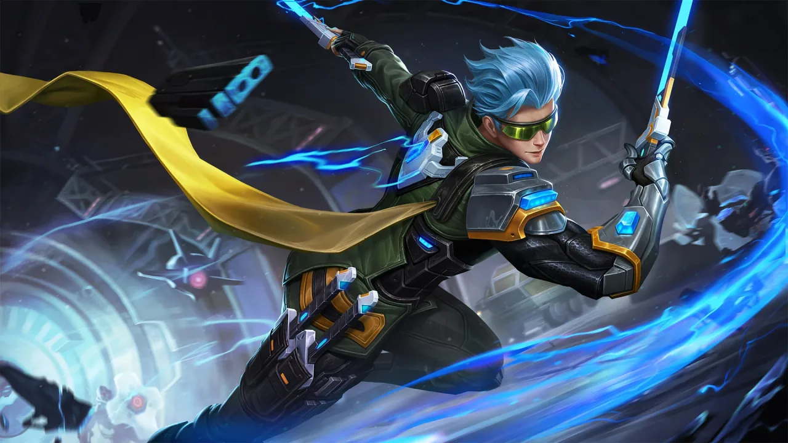

[Tier list](https://boostmlbb.ru/en/heroes/)[Items](https://boostmlbb.ru/en/items/)[Skins](https://boostmlbb.ru/en/skins/)[News & guides](https://boostmlbb.ru/en/news/)

[Skins](https://boostmlbb.ru/en/skins/)/[Gusion](https://boostmlbb.ru/en/skins/gusion.html)/Cyber Ops

[Gusion skin](https://boostmlbb.ru/en/skins/gusion.html)

# Cyber Ops

ExceptionalStarLightLimited

How to get

StarLight reward for October 2018.

Released

1 October 2018

## What the skin changes

-   New look
-   New skill effects
-   Showcase animation
-   Attribute bonus

## All Gusion skins [12](https://boostmlbb.ru/en/skins/gusion.html)

[Desert SpiderExceptional · 2024](https://boostmlbb.ru/en/skins/gusion/desert-spider.html)[K'Grand · 2024](https://boostmlbb.ru/en/skins/gusion/k.html)[Dimension WalkerGrand · 2023](https://boostmlbb.ru/en/skins/gusion/dimension-walker.html)[Soul RevelationDeluxe · 2023](https://boostmlbb.ru/en/skins/gusion/soul-revelation.html)[Cosmic GleamSupreme · 2022](https://boostmlbb.ru/en/skins/gusion/cosmic-gleam.html)[Night OwlExquisite · 2021](https://boostmlbb.ru/en/skins/gusion/night-owl.html)[V.E.N.O.M. Emperor ScorpionDeluxe · 2019](https://boostmlbb.ru/en/skins/gusion/v-e-n-o-m-emperor-scorpion.html)[Dangerous LiaisonExceptional · 2019](https://boostmlbb.ru/en/skins/gusion/dangerous-liaison.html)[Cyber OpsExceptional · 2018](https://boostmlbb.ru/en/skins/gusion/cyber-ops.html)[Hairsty­listCommon · 2018](https://boostmlbb.ru/en/skins/gusion/hairstylist.html)[Moonlight SonataCommon · 2018](https://boostmlbb.ru/en/skins/gusion/moonlight-sonata.html)[Minato Namikaze](https://boostmlbb.ru/en/skins/gusion/minato-namikaze.html)

## StarLight series

[Tideborn SailorKalea · 2026](https://boostmlbb.ru/en/skins/kalea/tideborn-sailor.html)[Kitsune's ShadowHayabusa · 2026](https://boostmlbb.ru/en/skins/hayabusa/kitsune-s-shadow.html)[Fangs of SlaughterHanzo · 2026](https://boostmlbb.ru/en/skins/hanzo/fangs-of-slaughter.html)[Smoul­dering FortressBelerick · 2026](https://boostmlbb.ru/en/skins/belerick/smouldering-fortress.html)[Magitech WraithObsidia · 2026](https://boostmlbb.ru/en/skins/obsidia/magitech-wraith.html)[Elysian LuminanceZetian · 2026](https://boostmlbb.ru/en/skins/zetian/elysian-luminance.html)[Guardian BattalionHilda · 2026](https://boostmlbb.ru/en/skins/hilda/guardian-battalion.html)[Dreaming KoiHarley · 2026](https://boostmlbb.ru/en/skins/harley/dreaming-koi.html)

**Rank up on Gusion**The calculator shows the price

[Calculate price](https://boostmlbb.ru/en/order.html?type=hero)

## Frequently asked questions

How to get the Cyber Ops skin for Gusion?

StarLight reward for October 2018.

When was Cyber Ops released?

1 October 2018.

What class is Cyber Ops?

Exceptional, StarLight series.
