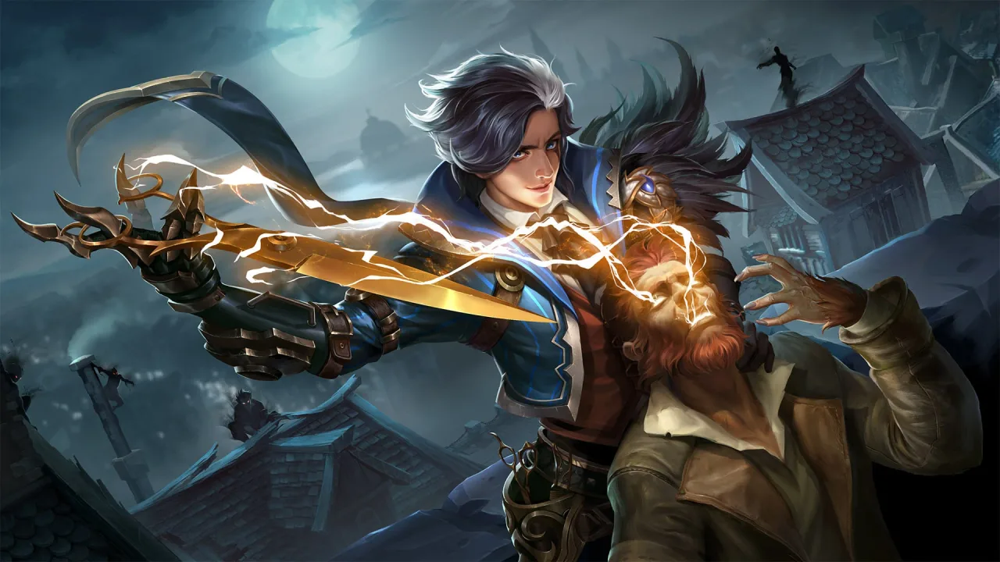

[Gusion skins](https://boostmlbb.ru/en/skins/gusion.html)

[Skins](https://boostmlbb.ru/en/skins/)/[Gusion](https://boostmlbb.ru/en/skins/gusion.html)/Hairstylist

[Gusion skin](https://boostmlbb.ru/en/skins/gusion.html)

# Hairstylist

CommonEliteIn the shop

How to get

Sold in the skin shop for 599 diamonds.

Price

599 diamonds

Released

August 2018

## What the skin changes

-   New look
-   Recoloured effects
-   Showcase animation
-   Attribute bonus

## Painted versions

The same skin in other colours. A painted version needs the skin itself.

-   **Gothic Hairstylist**188 diamonds

## All Gusion skins [12](https://boostmlbb.ru/en/skins/gusion.html)

[Desert SpiderExceptional · 2024](https://boostmlbb.ru/en/skins/gusion/desert-spider.html)[K'Grand · 2024](https://boostmlbb.ru/en/skins/gusion/k.html)[Dimension WalkerGrand · 2023](https://boostmlbb.ru/en/skins/gusion/dimension-walker.html)[Soul RevelationDeluxe · 2023](https://boostmlbb.ru/en/skins/gusion/soul-revelation.html)[Cosmic GleamSupreme · 2022](https://boostmlbb.ru/en/skins/gusion/cosmic-gleam.html)[Night OwlExquisite · 2021](https://boostmlbb.ru/en/skins/gusion/night-owl.html)[V.E.N.O.M. Emperor ScorpionDeluxe · 2019](https://boostmlbb.ru/en/skins/gusion/v-e-n-o-m-emperor-scorpion.html)[Dangerous LiaisonExceptional · 2019](https://boostmlbb.ru/en/skins/gusion/dangerous-liaison.html)[Cyber OpsExceptional · 2018](https://boostmlbb.ru/en/skins/gusion/cyber-ops.html)[Hairsty­listCommon · 2018](https://boostmlbb.ru/en/skins/gusion/hairstylist.html)[Moonlight SonataCommon · 2018](https://boostmlbb.ru/en/skins/gusion/moonlight-sonata.html)[Minato Namikaze](https://boostmlbb.ru/en/skins/gusion/minato-namikaze.html)

## Elite series

[Golden OsmanthusChang'e · 2026](https://boostmlbb.ru/en/skins/change/golden-osmanthus.html)[Warlord KingMartis · 2025](https://boostmlbb.ru/en/skins/martis/warlord-king.html)[High Seas CadetKimmy · 2024](https://boostmlbb.ru/en/skins/kimmy/high-seas-cadet.html)[Verdant LancerSilvanna · 2024](https://boostmlbb.ru/en/skins/silvanna/verdant-lancer.html)[Bloodhoof MarauderHylos · 2024](https://boostmlbb.ru/en/skins/hylos/bloodhoof-marauder.html)[Elegant ButterflyGuinevere · 2024](https://boostmlbb.ru/en/skins/guinevere/elegant-butterfly.html)[Marques of BladesLancelot · 2024](https://boostmlbb.ru/en/skins/lancelot/marques-of-blades.html)[Badlands HiatusChip · 2024](https://boostmlbb.ru/en/skins/chip/badlands-hiatus.html)

**How much is a rank boost on Gusion?**Choose your current and target ranks to see the price here.

[Calculate price](https://boostmlbb.ru/en/order.html?type=hero)

## Frequently asked questions

How to get the Hairstylist skin for Gusion?

Sold in the skin shop for 599 diamonds.

When was Hairstylist released?

August 2018.

What class is Hairstylist?

Common, Elite series.
