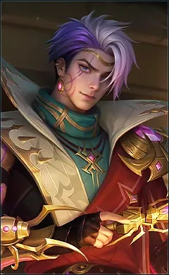

[Tier list](https://boostmlbb.ru/en/heroes/)[Items](https://boostmlbb.ru/en/items/)[Skins](https://boostmlbb.ru/en/skins/)[News & guides](https://boostmlbb.ru/en/news/)

[Skins](https://boostmlbb.ru/en/skins/)/[Gusion](https://boostmlbb.ru/en/skins/gusion.html)/K'

[Gusion skin](https://boostmlbb.ru/en/skins/gusion.html)

# K'

GrandKOFLimited

How to get

Released in the MLBB × KOF collaboration event. Limited skins come back in event draws from time to time.

Released

24 April 2024

## What the skin changes

-   New look
-   New skill effects
-   Skill sounds
-   Voice-over
-   Skill icons
-   Showcase animation
-   Showcase scene
-   Showcase music
-   Spawn animation
-   Special actions
-   Attribute bonus

## All Gusion skins [12](https://boostmlbb.ru/en/skins/gusion.html)

[Desert SpiderExceptional · 2024](https://boostmlbb.ru/en/skins/gusion/desert-spider.html)[K'Grand · 2024](https://boostmlbb.ru/en/skins/gusion/k.html)[Dimension WalkerGrand · 2023](https://boostmlbb.ru/en/skins/gusion/dimension-walker.html)[Soul RevelationDeluxe · 2023](https://boostmlbb.ru/en/skins/gusion/soul-revelation.html)[Cosmic GleamSupreme · 2022](https://boostmlbb.ru/en/skins/gusion/cosmic-gleam.html)[Night OwlExquisite · 2021](https://boostmlbb.ru/en/skins/gusion/night-owl.html)[V.E.N.O.M. Emperor ScorpionDeluxe · 2019](https://boostmlbb.ru/en/skins/gusion/v-e-n-o-m-emperor-scorpion.html)[Dangerous LiaisonExceptional · 2019](https://boostmlbb.ru/en/skins/gusion/dangerous-liaison.html)[Cyber OpsExceptional · 2018](https://boostmlbb.ru/en/skins/gusion/cyber-ops.html)[Hairsty­listCommon · 2018](https://boostmlbb.ru/en/skins/gusion/hairstylist.html)[Moonlight SonataCommon · 2018](https://boostmlbb.ru/en/skins/gusion/moonlight-sonata.html)[Minato Namikaze](https://boostmlbb.ru/en/skins/gusion/minato-namikaze.html)

## KOF series

[Kyo KusanagiValir · 2024](https://boostmlbb.ru/en/skins/valir/kyo-kusanagi.html)[Terry BogardPaquito · 2024](https://boostmlbb.ru/en/skins/paquito/terry-bogard.html)[Mai ShiranuiMasha · 2024](https://boostmlbb.ru/en/skins/masha/mai-shiranui.html)[Orochi ChrisDyrroth · 2020](https://boostmlbb.ru/en/skins/dyrroth/orochi-chris.html)[Kula DiamondAurora · 2019](https://boostmlbb.ru/en/skins/aurora/kula-diamond.html)[Athena AsamiyaGuinevere · 2019](https://boostmlbb.ru/en/skins/guinevere/athena-asamiya.html)[Iori YagamiChou · 2019](https://boostmlbb.ru/en/skins/chou/iori-yagami.html)[LeonaKarina · 2019](https://boostmlbb.ru/en/skins/karina/leona.html)

**Rank up on Gusion**The calculator shows the price

[Calculate price](https://boostmlbb.ru/en/order.html?type=hero)

## Frequently asked questions

How to get the K' skin for Gusion?

Released in the MLBB × KOF collaboration event. Limited skins come back in event draws from time to time.

When was K' released?

24 April 2024.

What class is K'?

Grand, KOF series.
