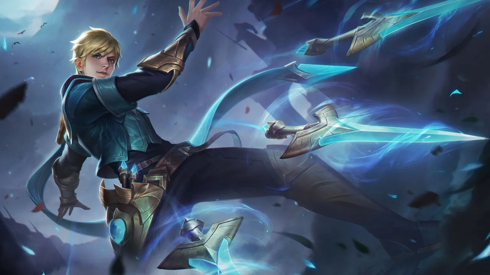

[Gusion skins](https://boostmlbb.ru/en/skins/gusion.html)

[Skins](https://boostmlbb.ru/en/skins/)/[Gusion](https://boostmlbb.ru/en/skins/gusion.html)/Moonlight Sonata

[Gusion skin](https://boostmlbb.ru/en/skins/gusion.html)

# Moonlight Sonata

CommonIn the shop

How to get

Sold in the skin shop for 269 diamonds.

Price

269 diamonds

Released

17 April 2018

## What the skin changes

-   Attribute bonus

## All Gusion skins [12](https://boostmlbb.ru/en/skins/gusion.html)

[Desert SpiderExceptional · 2024](https://boostmlbb.ru/en/skins/gusion/desert-spider.html)[K'Grand · 2024](https://boostmlbb.ru/en/skins/gusion/k.html)[Dimension WalkerGrand · 2023](https://boostmlbb.ru/en/skins/gusion/dimension-walker.html)[Soul RevelationDeluxe · 2023](https://boostmlbb.ru/en/skins/gusion/soul-revelation.html)[Cosmic GleamSupreme · 2022](https://boostmlbb.ru/en/skins/gusion/cosmic-gleam.html)[Night OwlExquisite · 2021](https://boostmlbb.ru/en/skins/gusion/night-owl.html)[V.E.N.O.M. Emperor ScorpionDeluxe · 2019](https://boostmlbb.ru/en/skins/gusion/v-e-n-o-m-emperor-scorpion.html)[Dangerous LiaisonExceptional · 2019](https://boostmlbb.ru/en/skins/gusion/dangerous-liaison.html)[Cyber OpsExceptional · 2018](https://boostmlbb.ru/en/skins/gusion/cyber-ops.html)[Hairsty­listCommon · 2018](https://boostmlbb.ru/en/skins/gusion/hairstylist.html)[Moonlight SonataCommon · 2018](https://boostmlbb.ru/en/skins/gusion/moonlight-sonata.html)[Minato Namikaze](https://boostmlbb.ru/en/skins/gusion/minato-namikaze.html)

**How much is a rank boost on Gusion?**Choose your current and target ranks to see the price here.

[Calculate price](https://boostmlbb.ru/en/order.html?type=hero)

## Frequently asked questions

How to get the Moonlight Sonata skin for Gusion?

Sold in the skin shop for 269 diamonds.

When was Moonlight Sonata released?

17 April 2018.

What class is Moonlight Sonata?

Common.
