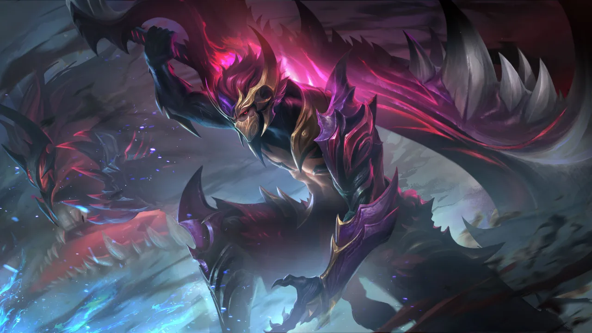

[All skins](https://boostmlbb.ru/en/skins/)

[Skins](https://boostmlbb.ru/en/skins/)/Hanzo

# Hanzo skins

Skins

5

In the shop

3

Latest

[Fangs of Slaughter](https://boostmlbb.ru/en/skins/hanzo/fangs-of-slaughter.html)2026

[Hero profile→](https://boostmlbb.ru/en/heroes/hanzo.html)

## All skins

[Fangs of SlaughterExceptional · 2026](https://boostmlbb.ru/en/skins/hanzo/fangs-of-slaughter.html)[Soulfire NetherlordExquisite · 2025](https://boostmlbb.ru/en/skins/hanzo/soulfire-netherlord.html)[Undead KingCommon · 2023](https://boostmlbb.ru/en/skins/hanzo/undead-king.html)[The Pale PhantomCommon · 2022](https://boostmlbb.ru/en/skins/hanzo/the-pale-phantom.html)[Insidious TutorExceptional · 2020](https://boostmlbb.ru/en/skins/hanzo/insidious-tutor.html)

**How much is a rank boost on Hanzo?**Choose your current and target ranks to see the price here.

[Calculate price](https://boostmlbb.ru/en/order.html?type=hero)

## Frequently asked questions

How many skins does Hanzo have?

5 skins, the default look not counted. The newest is Fangs of Slaughter (1 September 2026).

Which Hanzo skins can you buy now?

Undead King (599 diamonds), The Pale Phantom (269 diamonds), Insidious Tutor (749 diamonds). The other skins were limited and come back only in events.

What is the rarest Hanzo skin?

Soulfire Netherlord, Exquisite class, Collector series. The top prize of a Collector event draw, paid with diamonds. Limited skins come back in event draws from time to time.
