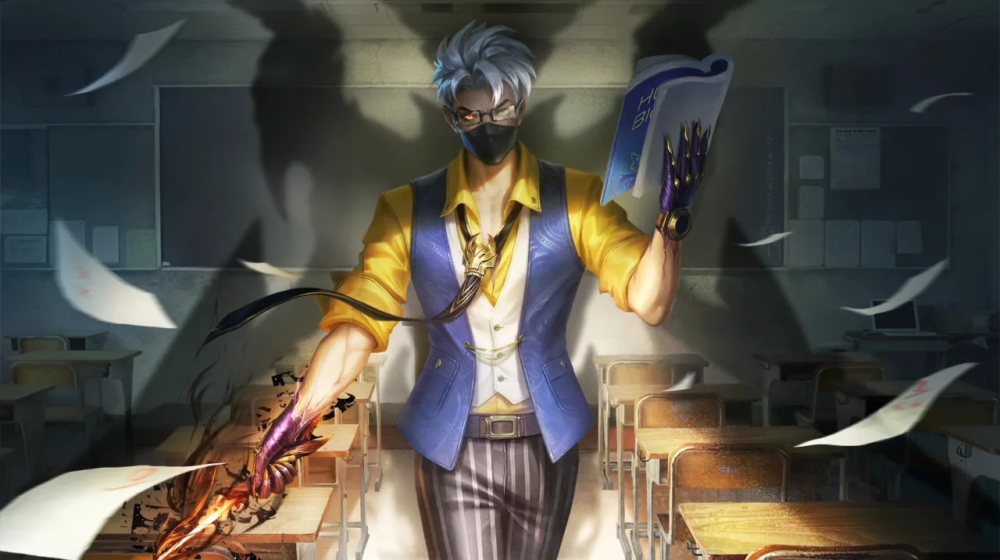

[Hanzo skins](https://boostmlbb.ru/en/skins/hanzo.html)

[Skins](https://boostmlbb.ru/en/skins/)/[Hanzo](https://boostmlbb.ru/en/skins/hanzo.html)/Insidious Tutor

[Hanzo skin](https://boostmlbb.ru/en/skins/hanzo.html)

# Insidious Tutor

ExceptionalSpecialIn the shop

How to get

Sold in the skin shop for 749 diamonds.

Price

749 diamonds

Released

10 August 2020

## What the skin changes

-   New look
-   New skill effects
-   Showcase animation
-   Attribute bonus

## Painted versions

The same skin in other colours. A painted version needs the skin itself.

-   **Evil Tutor**StarLight reward for January 2021.

## All Hanzo skins [5](https://boostmlbb.ru/en/skins/hanzo.html)

[Fangs of SlaughterExceptional · 2026](https://boostmlbb.ru/en/skins/hanzo/fangs-of-slaughter.html)[Soulfire NetherlordExquisite · 2025](https://boostmlbb.ru/en/skins/hanzo/soulfire-netherlord.html)[Undead KingCommon · 2023](https://boostmlbb.ru/en/skins/hanzo/undead-king.html)[The Pale PhantomCommon · 2022](https://boostmlbb.ru/en/skins/hanzo/the-pale-phantom.html)[Insidious TutorExceptional · 2020](https://boostmlbb.ru/en/skins/hanzo/insidious-tutor.html)

## Special series

[Arcane VerdictMathilda · 2026](https://boostmlbb.ru/en/skins/mathilda/arcane-verdict.html)[Windborne WaltzVale · 2026](https://boostmlbb.ru/en/skins/vale/windborne-waltz.html)[Captain of the LostFranco · 2026](https://boostmlbb.ru/en/skins/franco/captain-of-the-lost.html)[Waveb­reakerYi Sun-shin · 2025](https://boostmlbb.ru/en/skins/yi-sun-shin/wavebreaker.html)[Steel ArmsBadang · 2025](https://boostmlbb.ru/en/skins/badang/steel-arms.html)[Lady ParasolKagura · 2025](https://boostmlbb.ru/en/skins/kagura/lady-parasol.html)[Fathom TerrorAldous · 2025](https://boostmlbb.ru/en/skins/aldous/fathom-terror.html)[Moonglow TroupeChang'e · 2025](https://boostmlbb.ru/en/skins/change/moonglow-troupe.html)

**How much is a rank boost on Hanzo?**Choose your current and target ranks to see the price here.

[Calculate price](https://boostmlbb.ru/en/order.html?type=hero)

## Frequently asked questions

How to get the Insidious Tutor skin for Hanzo?

Sold in the skin shop for 749 diamonds.

When was Insidious Tutor released?

10 August 2020.

What class is Insidious Tutor?

Exceptional, Special series.
