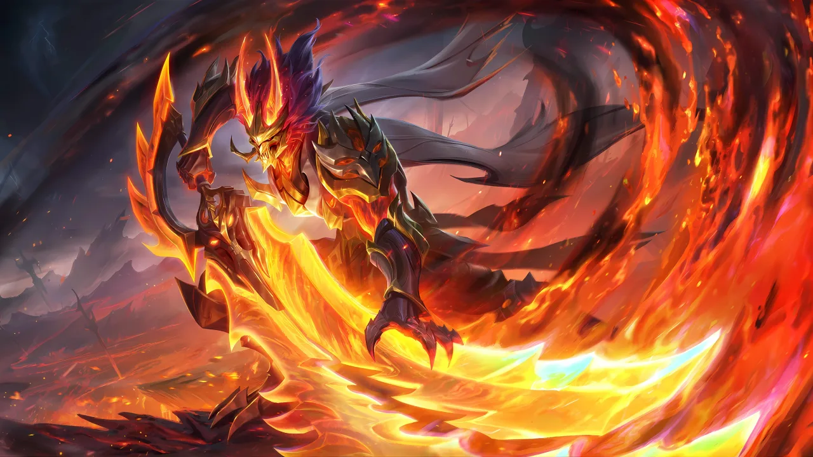

[Hanzo skins](https://boostmlbb.ru/en/skins/hanzo.html)

[Skins](https://boostmlbb.ru/en/skins/)/[Hanzo](https://boostmlbb.ru/en/skins/hanzo.html)/Soulfire Netherlord

[Hanzo skin](https://boostmlbb.ru/en/skins/hanzo.html)

# Soulfire Netherlord

ExquisiteCollectorLimited

How to get

The top prize of a Collector event draw, paid with diamonds. Limited skins come back in event draws from time to time.

Released

3 July 2025

## What the skin changes

-   New look
-   New skill effects
-   Skill sounds
-   Voice-over
-   Showcase animation
-   Showcase scene
-   Showcase music
-   Special actions
-   Attribute bonus

## All Hanzo skins [5](https://boostmlbb.ru/en/skins/hanzo.html)

[Fangs of SlaughterExceptional · 2026](https://boostmlbb.ru/en/skins/hanzo/fangs-of-slaughter.html)[Soulfire NetherlordExquisite · 2025](https://boostmlbb.ru/en/skins/hanzo/soulfire-netherlord.html)[Undead KingCommon · 2023](https://boostmlbb.ru/en/skins/hanzo/undead-king.html)[The Pale PhantomCommon · 2022](https://boostmlbb.ru/en/skins/hanzo/the-pale-phantom.html)[Insidious TutorExceptional · 2020](https://boostmlbb.ru/en/skins/hanzo/insidious-tutor.html)

## Collector series

[The PurifierBruno · 2026](https://boostmlbb.ru/en/skins/bruno/the-purifier.html)[Celestial RebelSun · 2026](https://boostmlbb.ru/en/skins/sun/celestial-rebel.html)[Kaiju of the DeepHelcurt · 2026](https://boostmlbb.ru/en/skins/helcurt/kaiju-of-the-deep.html)[Starbound SentryKimmy · 2026](https://boostmlbb.ru/en/skins/kimmy/starbound-sentry.html)[Dreaming MonarchAlice · 2026](https://boostmlbb.ru/en/skins/alice/dreaming-monarch.html)[Tremor of the DeepGrock · 2026](https://boostmlbb.ru/en/skins/grock/tremor-of-the-deep.html)[Celestial GeneralTigreal · 2026](https://boostmlbb.ru/en/skins/tigreal/celestial-general.html)[Sunborn MonarchXavier · 2026](https://boostmlbb.ru/en/skins/xavier/sunborn-monarch.html)

**How much is a rank boost on Hanzo?**Choose your current and target ranks to see the price here.

[Calculate price](https://boostmlbb.ru/en/order.html?type=hero)

## Frequently asked questions

How to get the Soulfire Netherlord skin for Hanzo?

The top prize of a Collector event draw, paid with diamonds. Limited skins come back in event draws from time to time.

When was Soulfire Netherlord released?

3 July 2025.

What class is Soulfire Netherlord?

Exquisite, Collector series.
