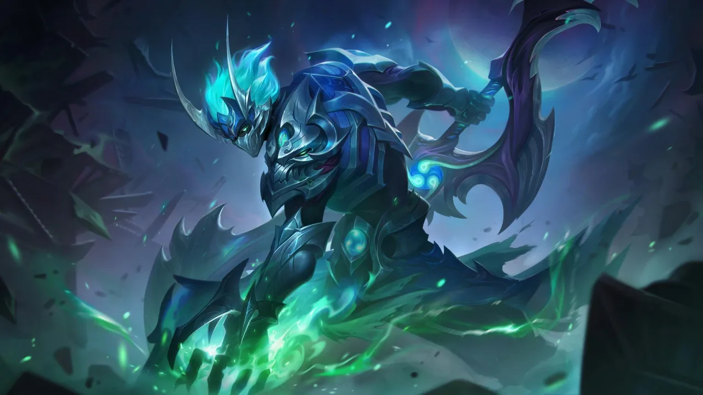

[Tier list](https://boostmlbb.ru/en/heroes/)[Items](https://boostmlbb.ru/en/items/)[Skins](https://boostmlbb.ru/en/skins/)[News & guides](https://boostmlbb.ru/en/news/)

[Skins](https://boostmlbb.ru/en/skins/)/[Hanzo](https://boostmlbb.ru/en/skins/hanzo.html)/The Pale Phantom

[Hanzo skin](https://boostmlbb.ru/en/skins/hanzo.html)

# The Pale Phantom

CommonIn the shop

How to get

Sold in the skin shop for 269 diamonds.

Price

269 diamonds

Released

22 February 2022

## What the skin changes

-   Attribute bonus

## All Hanzo skins [5](https://boostmlbb.ru/en/skins/hanzo.html)

[Fangs of SlaughterExceptional · 2026](https://boostmlbb.ru/en/skins/hanzo/fangs-of-slaughter.html)[Soulfire NetherlordExquisite · 2025](https://boostmlbb.ru/en/skins/hanzo/soulfire-netherlord.html)[Undead KingCommon · 2023](https://boostmlbb.ru/en/skins/hanzo/undead-king.html)[The Pale PhantomCommon · 2022](https://boostmlbb.ru/en/skins/hanzo/the-pale-phantom.html)[Insidious TutorExceptional · 2020](https://boostmlbb.ru/en/skins/hanzo/insidious-tutor.html)

**Rank up on Hanzo**The calculator shows the price

[Calculate price](https://boostmlbb.ru/en/order.html?type=hero)

## Frequently asked questions

How to get the The Pale Phantom skin for Hanzo?

Sold in the skin shop for 269 diamonds.

When was The Pale Phantom released?

22 February 2022.

What class is The Pale Phantom?

Common.
