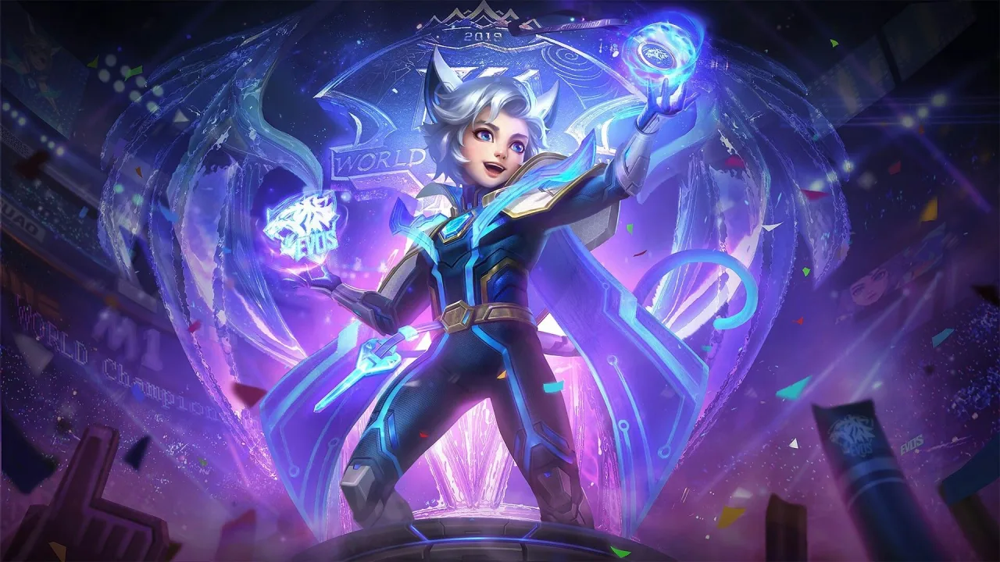
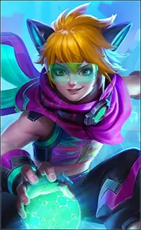

[Harith skins](https://boostmlbb.ru/en/skins/harith.html)

[Skins](https://boostmlbb.ru/en/skins/)/[Harith](https://boostmlbb.ru/en/skins/harith.html)/EVOS Legends

[Harith skin](https://boostmlbb.ru/en/skins/harith.html)

# EVOS Legends

DeluxeChampionLimited

How to get

Esports skin of Champion: it was released in the tournament event. Limited skins come back in event draws from time to time.

Released

3 April 2025

## What the skin changes

-   New look
-   New skill effects
-   Showcase animation
-   Showcase scene
-   Attribute bonus

## All Harith skins [8](https://boostmlbb.ru/en/skins/harith.html)

[EVOS LegendsDeluxe · 2025](https://boostmlbb.ru/en/skins/harith/evos-legends.html)[Christmas CarnivalExceptional · 2025](https://boostmlbb.ru/en/skins/harith/christmas-carnival.html)[KilluaGrand · 2025](https://boostmlbb.ru/en/skins/harith/killua.html)[PsychicExquisite · 2024](https://boostmlbb.ru/en/skins/harith/psychic.html)[Fashion ExpertExceptional · 2021](https://boostmlbb.ru/en/skins/harith/fashion-expert.html)[Lightborn - InspirerDeluxe · 2018](https://boostmlbb.ru/en/skins/harith/lightborn-inspirer.html)[Savannah CatCommon · 2018](https://boostmlbb.ru/en/skins/harith/savannah-cat.html)[StardustCommon · 2018](https://boostmlbb.ru/en/skins/harith/stardust.html)

## Champion series

[APBrenBrody · 2024](https://boostmlbb.ru/en/skins/brody/apbren.html)[Blacklist Interna­tionalEstes · 2024](https://boostmlbb.ru/en/skins/estes/blacklist-international.html)[ECHOChou · 2023](https://boostmlbb.ru/en/skins/chou/echo.html)[Bren EsportsLancelot · 2020](https://boostmlbb.ru/en/skins/lancelot/bren-esports.html)

**How much is a rank boost on Harith?**Choose your current and target ranks to see the price here.

[Calculate price](https://boostmlbb.ru/en/order.html?type=hero)

## Frequently asked questions

How to get the EVOS Legends skin for Harith?

Esports skin of Champion: it was released in the tournament event. Limited skins come back in event draws from time to time.

When was EVOS Legends released?

3 April 2025.

What class is EVOS Legends?

Deluxe, Champion series.
