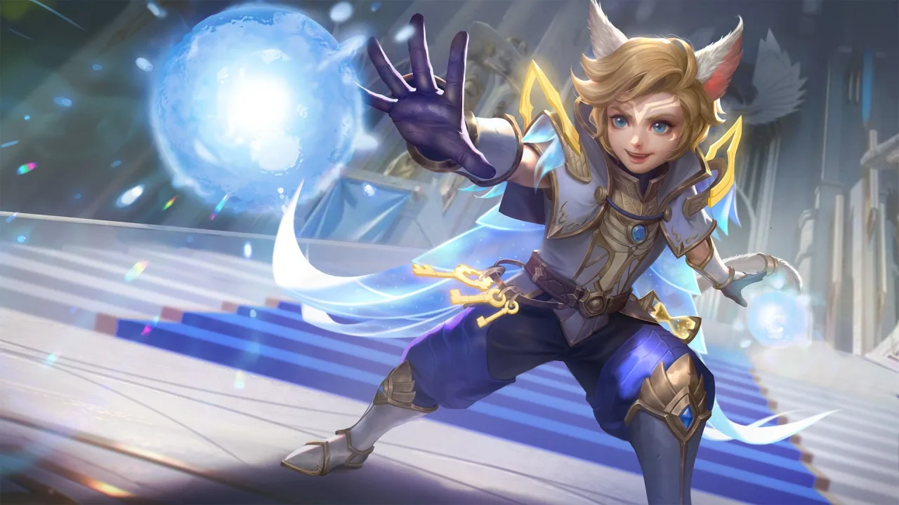

[Tier list](https://boostmlbb.ru/en/heroes/)[Items](https://boostmlbb.ru/en/items/)[Skins](https://boostmlbb.ru/en/skins/)[News & guides](https://boostmlbb.ru/en/news/)

[Skins](https://boostmlbb.ru/en/skins/)/[Harith](https://boostmlbb.ru/en/skins/harith.html)/Lightborn - Inspirer

[Harith skin](https://boostmlbb.ru/en/skins/harith.html)

# Lightborn - Inspirer

DeluxeLightbornIn the shop

How to get

Sold in the skin shop for 1,080 diamonds.

Price

1,080 diamonds

Released

22 November 2018

## What the skin changes

-   New look
-   New skill effects
-   Showcase animation
-   Showcase scene
-   Attribute bonus

## All Harith skins [8](https://boostmlbb.ru/en/skins/harith.html)

[EVOS LegendsDeluxe · 2025](https://boostmlbb.ru/en/skins/harith/evos-legends.html)[Christmas CarnivalExceptional · 2025](https://boostmlbb.ru/en/skins/harith/christmas-carnival.html)[KilluaGrand · 2025](https://boostmlbb.ru/en/skins/harith/killua.html)[PsychicExquisite · 2024](https://boostmlbb.ru/en/skins/harith/psychic.html)[Fashion ExpertExceptional · 2021](https://boostmlbb.ru/en/skins/harith/fashion-expert.html)[Lightborn - InspirerDeluxe · 2018](https://boostmlbb.ru/en/skins/harith/lightborn-inspirer.html)[Savannah CatCommon · 2018](https://boostmlbb.ru/en/skins/harith/savannah-cat.html)[StardustCommon · 2018](https://boostmlbb.ru/en/skins/harith/stardust.html)

## Lightborn series

[Lightborn - OverriderGranger · 2024](https://boostmlbb.ru/en/skins/granger/lightborn-overrider.html)[Lightborn - RangerFanny · 2019](https://boostmlbb.ru/en/skins/fanny/lightborn-ranger.html)[Lightborn - StrikerAlucard · 2019](https://boostmlbb.ru/en/skins/alucard/lightborn-striker.html)[Lightborn - DefenderTigreal · 2019](https://boostmlbb.ru/en/skins/tigreal/lightborn-defender.html)

**Rank up on Harith**The calculator shows the price

[Calculate price](https://boostmlbb.ru/en/order.html?type=hero)

## Frequently asked questions

How to get the Lightborn - Inspirer skin for Harith?

Sold in the skin shop for 1,080 diamonds.

When was Lightborn - Inspirer released?

22 November 2018.

What class is Lightborn - Inspirer?

Deluxe, Lightborn series.
