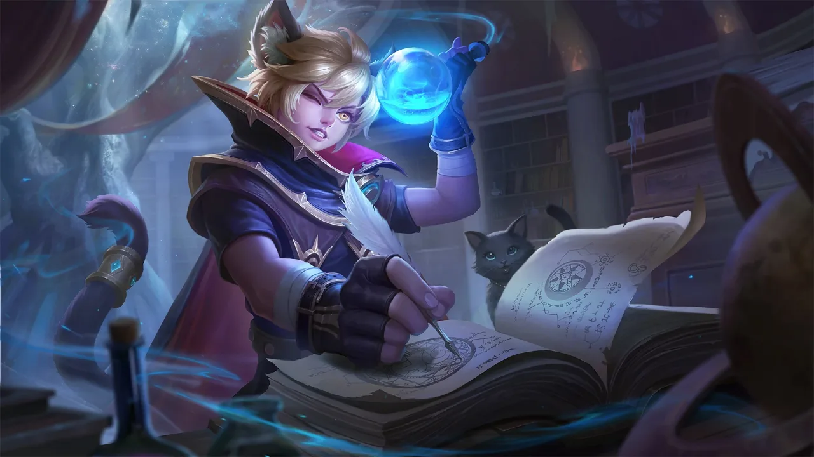

[Tier list](https://boostmlbb.ru/en/heroes/)[Items](https://boostmlbb.ru/en/items/)[Skins](https://boostmlbb.ru/en/skins/)[News & guides](https://boostmlbb.ru/en/news/)

[Skins](https://boostmlbb.ru/en/skins/)/[Harith](https://boostmlbb.ru/en/skins/harith.html)/Stardust

[Harith skin](https://boostmlbb.ru/en/skins/harith.html)

# Stardust

CommonEliteIn the shop

How to get

Sold in the skin shop for 599 diamonds.

Price

599 diamonds

Released

1 March 2018

## What the skin changes

-   New look
-   Recoloured effects
-   Showcase animation
-   Attribute bonus

## Painted versions

The same skin in other colours. A painted version needs the skin itself.

-   **Wayfarer**StarLight reward for May 2022.

## All Harith skins [8](https://boostmlbb.ru/en/skins/harith.html)

[EVOS LegendsDeluxe · 2025](https://boostmlbb.ru/en/skins/harith/evos-legends.html)[Christmas CarnivalExceptional · 2025](https://boostmlbb.ru/en/skins/harith/christmas-carnival.html)[KilluaGrand · 2025](https://boostmlbb.ru/en/skins/harith/killua.html)[PsychicExquisite · 2024](https://boostmlbb.ru/en/skins/harith/psychic.html)[Fashion ExpertExceptional · 2021](https://boostmlbb.ru/en/skins/harith/fashion-expert.html)[Lightborn - InspirerDeluxe · 2018](https://boostmlbb.ru/en/skins/harith/lightborn-inspirer.html)[Savannah CatCommon · 2018](https://boostmlbb.ru/en/skins/harith/savannah-cat.html)[StardustCommon · 2018](https://boostmlbb.ru/en/skins/harith/stardust.html)

## Elite series

[Golden OsmanthusChang'e · 2026](https://boostmlbb.ru/en/skins/change/golden-osmanthus.html)[Warlord KingMartis · 2025](https://boostmlbb.ru/en/skins/martis/warlord-king.html)[High Seas CadetKimmy · 2024](https://boostmlbb.ru/en/skins/kimmy/high-seas-cadet.html)[Verdant LancerSilvanna · 2024](https://boostmlbb.ru/en/skins/silvanna/verdant-lancer.html)[Bloodhoof MarauderHylos · 2024](https://boostmlbb.ru/en/skins/hylos/bloodhoof-marauder.html)[Elegant ButterflyGuinevere · 2024](https://boostmlbb.ru/en/skins/guinevere/elegant-butterfly.html)[Marques of BladesLancelot · 2024](https://boostmlbb.ru/en/skins/lancelot/marques-of-blades.html)[Badlands HiatusChip · 2024](https://boostmlbb.ru/en/skins/chip/badlands-hiatus.html)

**Rank up on Harith**The calculator shows the price

[Calculate price](https://boostmlbb.ru/en/order.html?type=hero)

## Frequently asked questions

How to get the Stardust skin for Harith?

Sold in the skin shop for 599 diamonds.

When was Stardust released?

1 March 2018.

What class is Stardust?

Common, Elite series.
