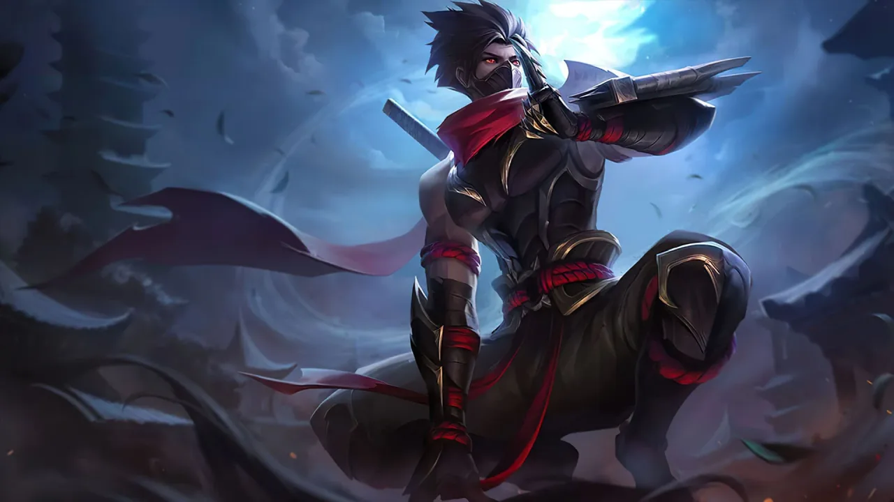
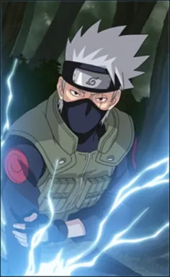

[All skins](https://boostmlbb.ru/en/skins/)

[Skins](https://boostmlbb.ru/en/skins/)/Hayabusa

# Hayabusa skins

Skins

11

In the shop

3

Latest

[Kitsune's Shadow](https://boostmlbb.ru/en/skins/hayabusa/kitsune-s-shadow.html)2026

[Hero profile→](https://boostmlbb.ru/en/heroes/hayabusa.html)

## All skins

AllGrandExquisiteExceptionalCommon

[Kitsune's ShadowExceptional · 2026](https://boostmlbb.ru/en/skins/hayabusa/kitsune-s-shadow.html)[Kakashi HatakeGrand · 2025](https://boostmlbb.ru/en/skins/hayabusa/kakashi-hatake.html)[Exorcist HayabusaGrand · 2024](https://boostmlbb.ru/en/skins/hayabusa/exorcist-hayabusa.html)[Techie NinjaCommon · 2022](https://boostmlbb.ru/en/skins/hayabusa/techie-ninja.html)[ShuraGrand · 2021](https://boostmlbb.ru/en/skins/hayabusa/shura.html)[Biological WeaponExceptional · 2020](https://boostmlbb.ru/en/skins/hayabusa/biological-weapon.html)[Shadow of ObscurityExquisite · 2019](https://boostmlbb.ru/en/skins/hayabusa/shadow-of-obscurity.html)[Sushi MasterExceptional · 2019](https://boostmlbb.ru/en/skins/hayabusa/sushi-master.html)[Experiment 21Exquisite · 2018](https://boostmlbb.ru/en/skins/hayabusa/experiment-21.html)[Future EnforcerCommon · 2017](https://boostmlbb.ru/en/skins/hayabusa/future-enforcer.html)[Spacetime ShadowCommon · 2016](https://boostmlbb.ru/en/skins/hayabusa/spacetime-shadow.html)

**How much is a rank boost on Hayabusa?**Choose your current and target ranks to see the price here.

[Calculate price](https://boostmlbb.ru/en/order.html?type=hero)

## Frequently asked questions

How many skins does Hayabusa have?

11 skins, the default look not counted. The newest is Kitsune's Shadow (1 October 2026).

Which Hayabusa skins can you buy now?

Sushi Master (749 diamonds), Future Enforcer (599 diamonds), Spacetime Shadow (269 diamonds). The other skins were limited and come back only in events.

What is the rarest Hayabusa skin?

Kakashi Hatake, Grand class, Naruto series. Released in the MLBB × Naruto collaboration event. Limited skins come back in event draws from time to time.
