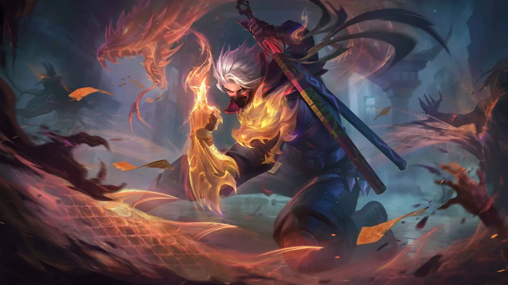

[Tier list](https://boostmlbb.ru/en/heroes/)[Items](https://boostmlbb.ru/en/items/)[Skins](https://boostmlbb.ru/en/skins/)[News & guides](https://boostmlbb.ru/en/news/)

[Skins](https://boostmlbb.ru/en/skins/)/[Hayabusa](https://boostmlbb.ru/en/skins/hayabusa.html)/Exorcist Hayabusa

[Hayabusa skin](https://boostmlbb.ru/en/skins/hayabusa.html)

# Exorcist Hayabusa

GrandThe ExorcistsLimited

How to get

Released in the The Exorcists event. Limited skins come back in event draws from time to time.

Released

May 2024

## What the skin changes

-   New look
-   New skill effects
-   Skill sounds
-   Voice-over
-   Skill icons
-   Showcase animation
-   Showcase scene
-   Showcase music
-   Spawn animation
-   Special actions
-   Attribute bonus

## All Hayabusa skins [11](https://boostmlbb.ru/en/skins/hayabusa.html)

[Kitsune's ShadowExceptional · 2026](https://boostmlbb.ru/en/skins/hayabusa/kitsune-s-shadow.html)[Kakashi HatakeGrand · 2025](https://boostmlbb.ru/en/skins/hayabusa/kakashi-hatake.html)[Exorcist HayabusaGrand · 2024](https://boostmlbb.ru/en/skins/hayabusa/exorcist-hayabusa.html)[Techie NinjaCommon · 2022](https://boostmlbb.ru/en/skins/hayabusa/techie-ninja.html)[ShuraGrand · 2021](https://boostmlbb.ru/en/skins/hayabusa/shura.html)[Biological WeaponExceptional · 2020](https://boostmlbb.ru/en/skins/hayabusa/biological-weapon.html)[Shadow of ObscurityExquisite · 2019](https://boostmlbb.ru/en/skins/hayabusa/shadow-of-obscurity.html)[Sushi MasterExceptional · 2019](https://boostmlbb.ru/en/skins/hayabusa/sushi-master.html)[Experiment 21Exquisite · 2018](https://boostmlbb.ru/en/skins/hayabusa/experiment-21.html)[Future EnforcerCommon · 2017](https://boostmlbb.ru/en/skins/hayabusa/future-enforcer.html)[Spacetime ShadowCommon · 2016](https://boostmlbb.ru/en/skins/hayabusa/spacetime-shadow.html)

## The Exorcists series

[Exorcist GrangerGranger · 2023](https://boostmlbb.ru/en/skins/granger/exorcist-granger.html)[Exorcist Yu ZhongYu Zhong · 2022](https://boostmlbb.ru/en/skins/yu-zhong/exorcist-yu-zhong.html)[Exorcist KaguraKagura · 2022](https://boostmlbb.ru/en/skins/kagura/exorcist-kagura.html)

**Rank up on Hayabusa**The calculator shows the price

[Calculate price](https://boostmlbb.ru/en/order.html?type=hero)

## Frequently asked questions

How to get the Exorcist Hayabusa skin for Hayabusa?

Released in the The Exorcists event. Limited skins come back in event draws from time to time.

When was Exorcist Hayabusa released?

May 2024.

What class is Exorcist Hayabusa?

Grand, The Exorcists series.
