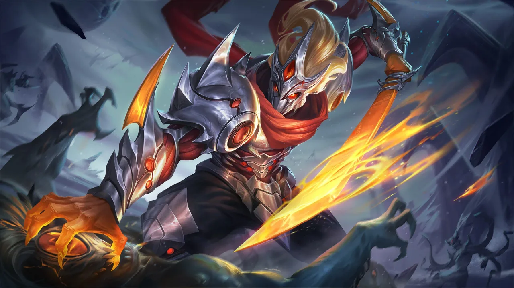

[Hayabusa skins](https://boostmlbb.ru/en/skins/hayabusa.html)

[Skins](https://boostmlbb.ru/en/skins/)/[Hayabusa](https://boostmlbb.ru/en/skins/hayabusa.html)/Experiment 21

[Hayabusa skin](https://boostmlbb.ru/en/skins/hayabusa.html)

# Experiment 21

ExquisiteAnnual StarLightLimited

How to get

StarLight Fest 2018 event.

Released

2018

## What the skin changes

-   New look
-   New skill effects
-   Skill sounds
-   Voice-over
-   Showcase animation
-   Showcase scene
-   Attribute bonus

## All Hayabusa skins [11](https://boostmlbb.ru/en/skins/hayabusa.html)

[Kitsune's ShadowExceptional · 2026](https://boostmlbb.ru/en/skins/hayabusa/kitsune-s-shadow.html)[Kakashi HatakeGrand · 2025](https://boostmlbb.ru/en/skins/hayabusa/kakashi-hatake.html)[Exorcist HayabusaGrand · 2024](https://boostmlbb.ru/en/skins/hayabusa/exorcist-hayabusa.html)[Techie NinjaCommon · 2022](https://boostmlbb.ru/en/skins/hayabusa/techie-ninja.html)[ShuraGrand · 2021](https://boostmlbb.ru/en/skins/hayabusa/shura.html)[Biological WeaponExceptional · 2020](https://boostmlbb.ru/en/skins/hayabusa/biological-weapon.html)[Shadow of ObscurityExquisite · 2019](https://boostmlbb.ru/en/skins/hayabusa/shadow-of-obscurity.html)[Sushi MasterExceptional · 2019](https://boostmlbb.ru/en/skins/hayabusa/sushi-master.html)[Experiment 21Exquisite · 2018](https://boostmlbb.ru/en/skins/hayabusa/experiment-21.html)[Future EnforcerCommon · 2017](https://boostmlbb.ru/en/skins/hayabusa/future-enforcer.html)[Spacetime ShadowCommon · 2016](https://boostmlbb.ru/en/skins/hayabusa/spacetime-shadow.html)

## Annual StarLight series

[Concerto of LightVale · 2024](https://boostmlbb.ru/en/skins/vale/concerto-of-light.html)[Avatar of TimeAngela · 2023](https://boostmlbb.ru/en/skins/angela/avatar-of-time.html)[Hawk-eyed SniperLesley · 2021](https://boostmlbb.ru/en/skins/lesley/hawk-eyed-sniper.html)[Water LilyKagura · 2021](https://boostmlbb.ru/en/skins/kagura/water-lily.html)[Neon LightwheelKarrie · 2020](https://boostmlbb.ru/en/skins/karrie/neon-lightwheel.html)[No.1 ControllerGord · 2019](https://boostmlbb.ru/en/skins/gord/no-1-controller.html)

**How much is a rank boost on Hayabusa?**Choose your current and target ranks to see the price here.

[Calculate price](https://boostmlbb.ru/en/order.html?type=hero)

## Frequently asked questions

How to get the Experiment 21 skin for Hayabusa?

StarLight Fest 2018 event.

When was Experiment 21 released?

2018.

What class is Experiment 21?

Exquisite, Annual StarLight series.
