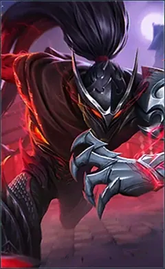

[Tier list](https://boostmlbb.ru/en/heroes/)[Items](https://boostmlbb.ru/en/items/)[Skins](https://boostmlbb.ru/en/skins/)[News & guides](https://boostmlbb.ru/en/news/)

[Skins](https://boostmlbb.ru/en/skins/)/[Hayabusa](https://boostmlbb.ru/en/skins/hayabusa.html)/Kakashi Hatake

[Hayabusa skin](https://boostmlbb.ru/en/skins/hayabusa.html)

# Kakashi Hatake

GrandNarutoLimited

How to get

Released in the MLBB × Naruto collaboration event. Limited skins come back in event draws from time to time.

Released

2 May 2025

## What the skin changes

-   New look
-   New skill effects
-   Skill sounds
-   Voice-over
-   Skill icons
-   Showcase animation
-   Showcase scene
-   Showcase music
-   Spawn animation
-   Special actions
-   Attribute bonus

## All Hayabusa skins [11](https://boostmlbb.ru/en/skins/hayabusa.html)

[Kitsune's ShadowExceptional · 2026](https://boostmlbb.ru/en/skins/hayabusa/kitsune-s-shadow.html)[Kakashi HatakeGrand · 2025](https://boostmlbb.ru/en/skins/hayabusa/kakashi-hatake.html)[Exorcist HayabusaGrand · 2024](https://boostmlbb.ru/en/skins/hayabusa/exorcist-hayabusa.html)[Techie NinjaCommon · 2022](https://boostmlbb.ru/en/skins/hayabusa/techie-ninja.html)[ShuraGrand · 2021](https://boostmlbb.ru/en/skins/hayabusa/shura.html)[Biological WeaponExceptional · 2020](https://boostmlbb.ru/en/skins/hayabusa/biological-weapon.html)[Shadow of ObscurityExquisite · 2019](https://boostmlbb.ru/en/skins/hayabusa/shadow-of-obscurity.html)[Sushi MasterExceptional · 2019](https://boostmlbb.ru/en/skins/hayabusa/sushi-master.html)[Experiment 21Exquisite · 2018](https://boostmlbb.ru/en/skins/hayabusa/experiment-21.html)[Future EnforcerCommon · 2017](https://boostmlbb.ru/en/skins/hayabusa/future-enforcer.html)[Spacetime ShadowCommon · 2016](https://boostmlbb.ru/en/skins/hayabusa/spacetime-shadow.html)

## Naruto series

[Sakura HarunoKalea · 2025](https://boostmlbb.ru/en/skins/kalea/sakura-haruno.html)[Naruto UzumakiLukas · 2025](https://boostmlbb.ru/en/skins/lukas/naruto-uzumaki.html)[Sasuke UchihaSuyou · 2025](https://boostmlbb.ru/en/skins/suyou/sasuke-uchiha.html)[GaaraVale · 2025](https://boostmlbb.ru/en/skins/vale/gaara.html)

**Rank up on Hayabusa**The calculator shows the price

[Calculate price](https://boostmlbb.ru/en/order.html?type=hero)

## Frequently asked questions

How to get the Kakashi Hatake skin for Hayabusa?

Released in the MLBB × Naruto collaboration event. Limited skins come back in event draws from time to time.

When was Kakashi Hatake released?

2 May 2025.

What class is Kakashi Hatake?

Grand, Naruto series.
