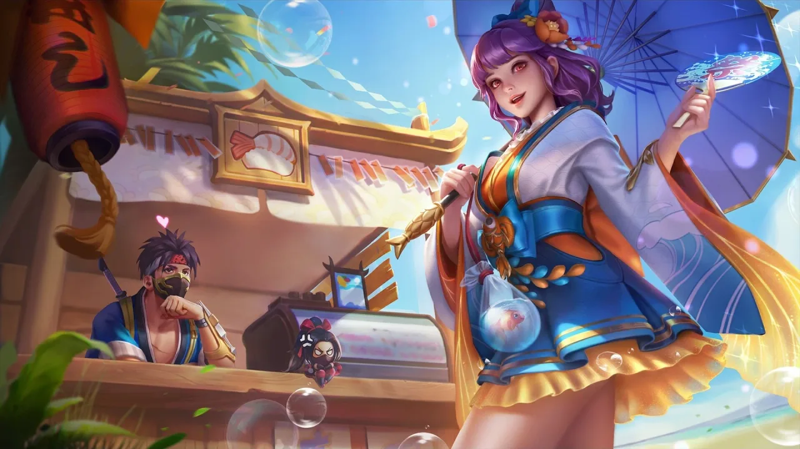

[Hayabusa skins](https://boostmlbb.ru/en/skins/hayabusa.html)

[Skins](https://boostmlbb.ru/en/skins/)/[Hayabusa](https://boostmlbb.ru/en/skins/hayabusa.html)/Sushi Master

[Hayabusa skin](https://boostmlbb.ru/en/skins/hayabusa.html)

# Sushi Master

ExceptionalSummerIn the shop

How to get

Sold in the skin shop for 749 diamonds.

Price

749 diamonds

Released

2019

## What the skin changes

-   New look
-   New skill effects
-   Showcase animation
-   Showcase scene
-   Attribute bonus

## Painted versions

The same skin in other colours. A painted version needs the skin itself.

-   **Sushi Master - Purple**188 diamonds

## All Hayabusa skins [11](https://boostmlbb.ru/en/skins/hayabusa.html)

[Kitsune's ShadowExceptional · 2026](https://boostmlbb.ru/en/skins/hayabusa/kitsune-s-shadow.html)[Kakashi HatakeGrand · 2025](https://boostmlbb.ru/en/skins/hayabusa/kakashi-hatake.html)[Exorcist HayabusaGrand · 2024](https://boostmlbb.ru/en/skins/hayabusa/exorcist-hayabusa.html)[Techie NinjaCommon · 2022](https://boostmlbb.ru/en/skins/hayabusa/techie-ninja.html)[ShuraGrand · 2021](https://boostmlbb.ru/en/skins/hayabusa/shura.html)[Biological WeaponExceptional · 2020](https://boostmlbb.ru/en/skins/hayabusa/biological-weapon.html)[Shadow of ObscurityExquisite · 2019](https://boostmlbb.ru/en/skins/hayabusa/shadow-of-obscurity.html)[Sushi MasterExceptional · 2019](https://boostmlbb.ru/en/skins/hayabusa/sushi-master.html)[Experiment 21Exquisite · 2018](https://boostmlbb.ru/en/skins/hayabusa/experiment-21.html)[Future EnforcerCommon · 2017](https://boostmlbb.ru/en/skins/hayabusa/future-enforcer.html)[Spacetime ShadowCommon · 2016](https://boostmlbb.ru/en/skins/hayabusa/spacetime-shadow.html)

## Summer series

[Summer SplashWanwan · 2025](https://boostmlbb.ru/en/skins/wanwan/summer-splash.html)[Yatai WaitressFloryn · 2024](https://boostmlbb.ru/en/skins/floryn/yatai-waitress.html)[Summer BreezeGuinevere · 2024](https://boostmlbb.ru/en/skins/guinevere/summer-breeze.html)[LifeguardClaude · 2024](https://boostmlbb.ru/en/skins/claude/lifeguard.html)[Summer WavesZilong · 2020](https://boostmlbb.ru/en/skins/zilong/summer-waves.html)[Summer VibesAngela · 2019](https://boostmlbb.ru/en/skins/angela/summer-vibes.html)[SundressNana · 2019](https://boostmlbb.ru/en/skins/nana/sundress.html)[Summer FestivalKagura · 2019](https://boostmlbb.ru/en/skins/kagura/summer-festival.html)

**How much is a rank boost on Hayabusa?**Choose your current and target ranks to see the price here.

[Calculate price](https://boostmlbb.ru/en/order.html?type=hero)

## Frequently asked questions

How to get the Sushi Master skin for Hayabusa?

Sold in the skin shop for 749 diamonds.

When was Sushi Master released?

2019.

What class is Sushi Master?

Exceptional, Summer series.
