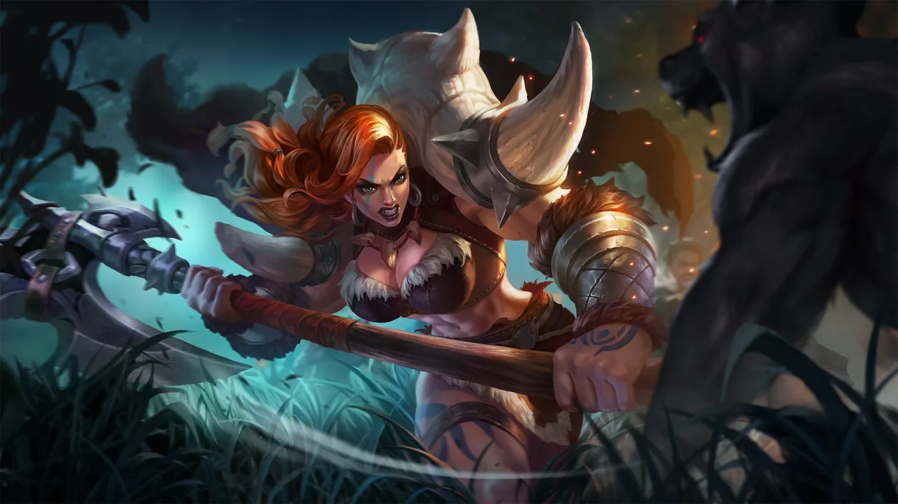
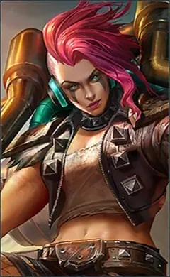

[Tier list](https://boostmlbb.ru/en/heroes/)[Items](https://boostmlbb.ru/en/items/)[Skins](https://boostmlbb.ru/en/skins/)[News & guides](https://boostmlbb.ru/en/news/)

[Skins](https://boostmlbb.ru/en/skins/)/Hilda

# Hilda skins

Skins

6

In the shop

2

Latest

[Guardian Battalion](https://boostmlbb.ru/en/skins/hilda/guardian-battalion.html)2026

[Hero profile→](https://boostmlbb.ru/en/heroes/hilda.html)

## All skins

[Guardian Battalion2026](https://boostmlbb.ru/en/skins/hilda/guardian-battalion.html)[Bass CrazeExceptional · 2021](https://boostmlbb.ru/en/skins/hilda/bass-craze.html)[AriesDeluxe · 2019](https://boostmlbb.ru/en/skins/hilda/aries.html)[Sacred GuardCommon · 2018](https://boostmlbb.ru/en/skins/hilda/sacred-guard.html)[Flower of the WastesCommon · 2017](https://boostmlbb.ru/en/skins/hilda/flower-of-the-wastes.html)[Power of WildnessCommon · 2017](https://boostmlbb.ru/en/skins/hilda/power-of-wildness.html)

**Rank up on Hilda**The calculator shows the price

[Calculate price](https://boostmlbb.ru/en/order.html?type=hero)

## Frequently asked questions

How many skins does Hilda have?

6 skins, the default look not counted. The newest is Guardian Battalion (February 2026).

Which Hilda skins can you buy now?

Bass Craze (749 diamonds), Power of Wildness (269 diamonds). The other skins were limited and come back only in events.

What is the rarest Hilda skin?

Aries, Deluxe class, Zodiac series. Drawn in the Zodiac Summon.
