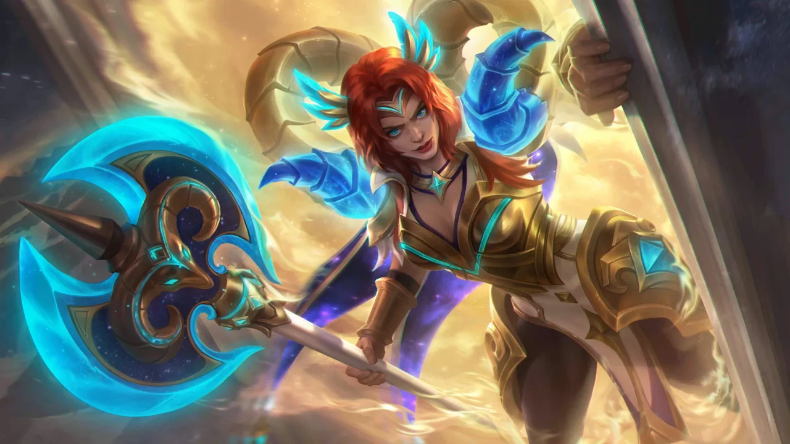

[Hilda skins](https://boostmlbb.ru/en/skins/hilda.html)

[Skins](https://boostmlbb.ru/en/skins/)/[Hilda](https://boostmlbb.ru/en/skins/hilda.html)/Aries

[Hilda skin](https://boostmlbb.ru/en/skins/hilda.html)

# Aries

DeluxeZodiacLimited

How to get

Drawn in the Zodiac Summon.

Released

21 March 2019

## What the skin changes

-   New look
-   New skill effects
-   Skill sounds
-   Voice-over
-   Showcase animation
-   Showcase scene
-   Attribute bonus

## All Hilda skins [6](https://boostmlbb.ru/en/skins/hilda.html)

[Guardian Battalion2026](https://boostmlbb.ru/en/skins/hilda/guardian-battalion.html)[Bass CrazeExceptional · 2021](https://boostmlbb.ru/en/skins/hilda/bass-craze.html)[AriesDeluxe · 2019](https://boostmlbb.ru/en/skins/hilda/aries.html)[Sacred GuardCommon · 2018](https://boostmlbb.ru/en/skins/hilda/sacred-guard.html)[Flower of the WastesCommon · 2017](https://boostmlbb.ru/en/skins/hilda/flower-of-the-wastes.html)[Power of WildnessCommon · 2017](https://boostmlbb.ru/en/skins/hilda/power-of-wildness.html)

## Zodiac series

[CapricornMartis · 2022](https://boostmlbb.ru/en/skins/martis/capricorn.html)[ScorpioHelcurt · 2019](https://boostmlbb.ru/en/skins/helcurt/scorpio.html)[LibraLunox · 2019](https://boostmlbb.ru/en/skins/lunox/libra.html)[LeoBadang · 2019](https://boostmlbb.ru/en/skins/badang/leo.html)[CancerZhask · 2019](https://boostmlbb.ru/en/skins/zhask/cancer.html)[Gemini - ShadowSelena · 2019](https://boostmlbb.ru/en/skins/selena/gemini-shadow.html)[Gemini - HaloKarina · 2019](https://boostmlbb.ru/en/skins/karina/gemini-halo.html)[TaurusMinotaur · 2019](https://boostmlbb.ru/en/skins/minotaur/taurus.html)

**How much is a rank boost on Hilda?**Choose your current and target ranks to see the price here.

[Calculate price](https://boostmlbb.ru/en/order.html?type=hero)

## Frequently asked questions

How to get the Aries skin for Hilda?

Drawn in the Zodiac Summon.

When was Aries released?

21 March 2019.

What class is Aries?

Deluxe, Zodiac series.
