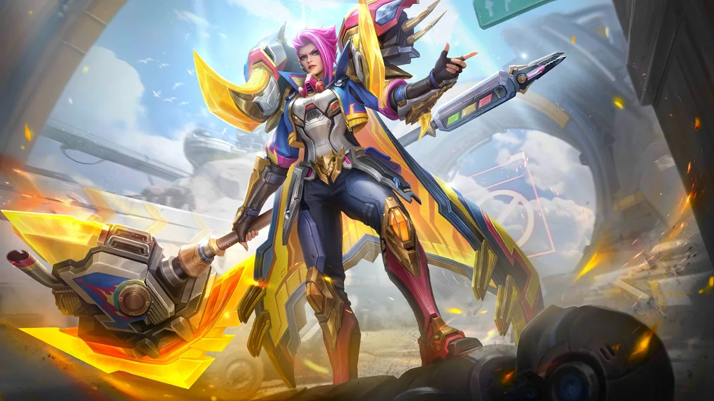
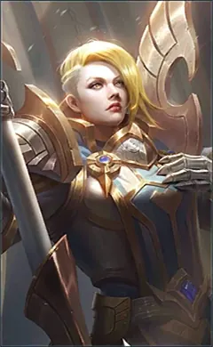

[Hilda skins](https://boostmlbb.ru/en/skins/hilda.html)

[Skins](https://boostmlbb.ru/en/skins/)/[Hilda](https://boostmlbb.ru/en/skins/hilda.html)/Guardian Battalion

[Hilda skin](https://boostmlbb.ru/en/skins/hilda.html)

# Guardian Battalion

StarLight

How to get

StarLight skin of February 2026: it was given for buying the StarLight pass that month. Limited skins come back in event draws from time to time.

Released

February 2026

## All Hilda skins [6](https://boostmlbb.ru/en/skins/hilda.html)

[Guardian Battalion2026](https://boostmlbb.ru/en/skins/hilda/guardian-battalion.html)[Bass CrazeExceptional · 2021](https://boostmlbb.ru/en/skins/hilda/bass-craze.html)[AriesDeluxe · 2019](https://boostmlbb.ru/en/skins/hilda/aries.html)[Sacred GuardCommon · 2018](https://boostmlbb.ru/en/skins/hilda/sacred-guard.html)[Flower of the WastesCommon · 2017](https://boostmlbb.ru/en/skins/hilda/flower-of-the-wastes.html)[Power of WildnessCommon · 2017](https://boostmlbb.ru/en/skins/hilda/power-of-wildness.html)

## StarLight series

[Tideborn SailorKalea · 2026](https://boostmlbb.ru/en/skins/kalea/tideborn-sailor.html)[Kitsune's ShadowHayabusa · 2026](https://boostmlbb.ru/en/skins/hayabusa/kitsune-s-shadow.html)[Fangs of SlaughterHanzo · 2026](https://boostmlbb.ru/en/skins/hanzo/fangs-of-slaughter.html)[Smoul­dering FortressBelerick · 2026](https://boostmlbb.ru/en/skins/belerick/smouldering-fortress.html)[Magitech WraithObsidia · 2026](https://boostmlbb.ru/en/skins/obsidia/magitech-wraith.html)[Elysian LuminanceZetian · 2026](https://boostmlbb.ru/en/skins/zetian/elysian-luminance.html)[Dreaming KoiHarley · 2026](https://boostmlbb.ru/en/skins/harley/dreaming-koi.html)[Royal MarshalFredrinn · 2025](https://boostmlbb.ru/en/skins/fredrinn/royal-marshal.html)

**How much is a rank boost on Hilda?**Choose your current and target ranks to see the price here.

[Calculate price](https://boostmlbb.ru/en/order.html?type=hero)

## Frequently asked questions

How to get the Guardian Battalion skin for Hilda?

StarLight skin of February 2026: it was given for buying the StarLight pass that month. Limited skins come back in event draws from time to time.

When was Guardian Battalion released?

February 2026.
