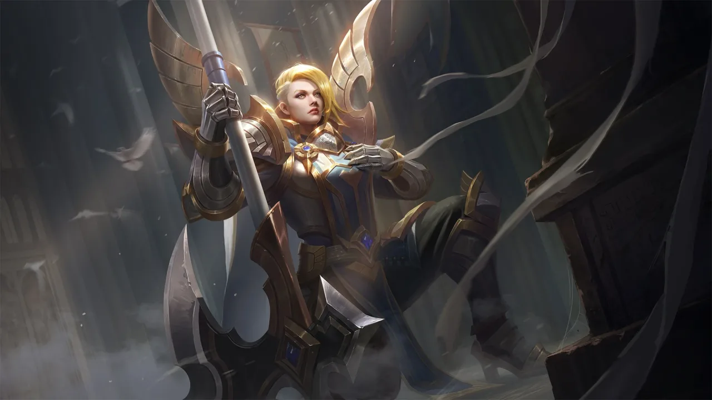

[Hilda skins](https://boostmlbb.ru/en/skins/hilda.html)

[Skins](https://boostmlbb.ru/en/skins/)/[Hilda](https://boostmlbb.ru/en/skins/hilda.html)/Sacred Guard

[Hilda skin](https://boostmlbb.ru/en/skins/hilda.html)

# Sacred Guard

CommonEliteLimited

How to get

Mentoring program reward.

Released

2018

## What the skin changes

-   New look
-   Recoloured effects
-   Showcase animation
-   Attribute bonus

## All Hilda skins [6](https://boostmlbb.ru/en/skins/hilda.html)

[Guardian Battalion2026](https://boostmlbb.ru/en/skins/hilda/guardian-battalion.html)[Bass CrazeExceptional · 2021](https://boostmlbb.ru/en/skins/hilda/bass-craze.html)[AriesDeluxe · 2019](https://boostmlbb.ru/en/skins/hilda/aries.html)[Sacred GuardCommon · 2018](https://boostmlbb.ru/en/skins/hilda/sacred-guard.html)[Flower of the WastesCommon · 2017](https://boostmlbb.ru/en/skins/hilda/flower-of-the-wastes.html)[Power of WildnessCommon · 2017](https://boostmlbb.ru/en/skins/hilda/power-of-wildness.html)

## Elite series

[Golden OsmanthusChang'e · 2026](https://boostmlbb.ru/en/skins/change/golden-osmanthus.html)[Warlord KingMartis · 2025](https://boostmlbb.ru/en/skins/martis/warlord-king.html)[High Seas CadetKimmy · 2024](https://boostmlbb.ru/en/skins/kimmy/high-seas-cadet.html)[Verdant LancerSilvanna · 2024](https://boostmlbb.ru/en/skins/silvanna/verdant-lancer.html)[Bloodhoof MarauderHylos · 2024](https://boostmlbb.ru/en/skins/hylos/bloodhoof-marauder.html)[Elegant ButterflyGuinevere · 2024](https://boostmlbb.ru/en/skins/guinevere/elegant-butterfly.html)[Marques of BladesLancelot · 2024](https://boostmlbb.ru/en/skins/lancelot/marques-of-blades.html)[Badlands HiatusChip · 2024](https://boostmlbb.ru/en/skins/chip/badlands-hiatus.html)

**How much is a rank boost on Hilda?**Choose your current and target ranks to see the price here.

[Calculate price](https://boostmlbb.ru/en/order.html?type=hero)

## Frequently asked questions

How to get the Sacred Guard skin for Hilda?

Mentoring program reward.

When was Sacred Guard released?

2018.

What class is Sacred Guard?

Common, Elite series.
