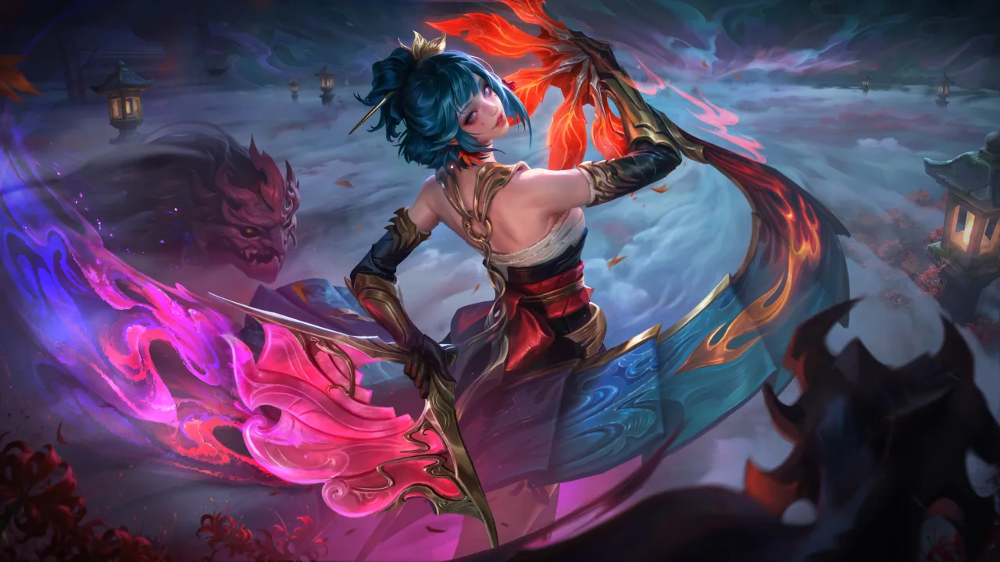

[Tier list](https://boostmlbb.ru/en/heroes/)[Items](https://boostmlbb.ru/en/items/)[Skins](https://boostmlbb.ru/en/skins/)[News & guides](https://boostmlbb.ru/en/news/)

[Skins](https://boostmlbb.ru/en/skins/)/Hirara

# Hirara skins

Skins

1

In the shop

1

Latest

[Gilded Embers](https://boostmlbb.ru/en/skins/hirara/gilded-embers.html)2026

[Hero profile→](https://boostmlbb.ru/en/heroes/hirara.html)

## All skins

[Gilded EmbersCommon · 2026](https://boostmlbb.ru/en/skins/hirara/gilded-embers.html)

**Rank up on Hirara**The calculator shows the price

[Calculate price](https://boostmlbb.ru/en/order.html?type=hero)

## Frequently asked questions

How many skins does Hirara have?

1 skin, the default look not counted. The newest is Gilded Embers (17 June 2026).

Which Hirara skins can you buy now?

Gilded Embers (269 diamonds). The other skins were limited and come back only in events.

What is the rarest Hirara skin?

Gilded Embers, Common class. Sold in the skin shop for 269 diamonds.
