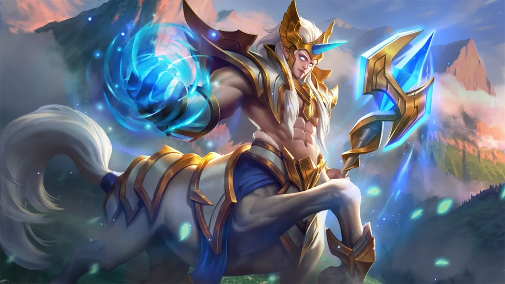

[Tier list](https://boostmlbb.ru/en/heroes/)[Items](https://boostmlbb.ru/en/items/)[Skins](https://boostmlbb.ru/en/skins/)[News & guides](https://boostmlbb.ru/en/news/)

[Skins](https://boostmlbb.ru/en/skins/)/Hylos

# Hylos skins

Skins

6

In the shop

2

Latest

[Lord of the Tundra](https://boostmlbb.ru/en/skins/hylos/lord-of-the-tundra.html)2025

[Hero profile→](https://boostmlbb.ru/en/heroes/hylos.html)

## All skins

[Lord of the TundraDeluxe · 2025](https://boostmlbb.ru/en/skins/hylos/lord-of-the-tundra.html)[Bloodhoof MarauderCommon · 2024](https://boostmlbb.ru/en/skins/hylos/bloodhoof-marauder.html)[Iron SteedDeluxe · 2021](https://boostmlbb.ru/en/skins/hylos/iron-steed.html)[Jungle WatcherCommon · 2019](https://boostmlbb.ru/en/skins/hylos/jungle-watcher.html)[Phantom SeerExceptional · 2018](https://boostmlbb.ru/en/skins/hylos/phantom-seer.html)[Abyssal ShamanCommon · 2018](https://boostmlbb.ru/en/skins/hylos/abyssal-shaman.html)

**Rank up on Hylos**The calculator shows the price

[Calculate price](https://boostmlbb.ru/en/order.html?type=hero)

## Frequently asked questions

How many skins does Hylos have?

6 skins, the default look not counted. The newest is Lord of the Tundra (18 December 2025).

Which Hylos skins can you buy now?

Phantom Seer (749 diamonds), Abyssal Shaman (599 diamonds). The other skins were limited and come back only in events.

What is the rarest Hylos skin?

Lord of the Tundra, Deluxe class, Mythic 2025 series. Price at release: 40 Myth Coins. Not sold in the shop now: it comes back only in events.
