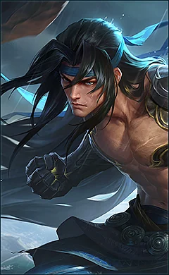
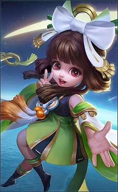
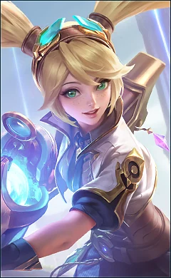
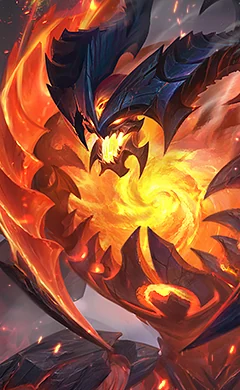
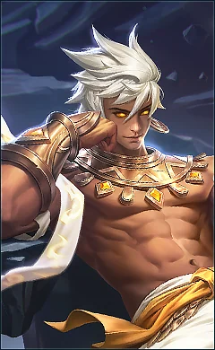

[Tier list](https://boostmlbb.ru/en/heroes/)[Items](https://boostmlbb.ru/en/items/)[Skins](https://boostmlbb.ru/en/skins/)[News & guides](https://boostmlbb.ru/en/news/)

# MLBB skins

946 skins of 133 heroes · prices and how to get them

Find a hero or a skin

Role

AllTankFighterAssassinMageMarksmanSupport

## New skins

[The PurifierBruno · 2026](https://boostmlbb.ru/en/skins/bruno/the-purifier.html)[Tideborn SailorKalea · 2026](https://boostmlbb.ru/en/skins/kalea/tideborn-sailor.html)[Ascendant of FlameZilong · 2026](https://boostmlbb.ru/en/skins/zilong/ascendant-of-flame.html)[Silverbolt RaikoSelena · 2026](https://boostmlbb.ru/en/skins/selena/silverbolt-raiko.html)[Prismatic RhythmLayla · 2026](https://boostmlbb.ru/en/skins/layla/prismatic-rhythm.html)[Imperatrix ArashiObsidia · 2026](https://boostmlbb.ru/en/skins/obsidia/imperatrix-arashi.html)[Celestial RebelSun · 2026](https://boostmlbb.ru/en/skins/sun/celestial-rebel.html)[Kitsune's ShadowHayabusa · 2026](https://boostmlbb.ru/en/skins/hayabusa/kitsune-s-shadow.html)[Golden OsmanthusChang'e · 2026](https://boostmlbb.ru/en/skins/change/golden-osmanthus.html)[Arcane VerdictMathilda · 2026](https://boostmlbb.ru/en/skins/mathilda/arcane-verdict.html)[Windborne WaltzVale · 2026](https://boostmlbb.ru/en/skins/vale/windborne-waltz.html)[Scarlet MusketeerClint · 2026](https://boostmlbb.ru/en/skins/clint/scarlet-musketeer.html)

## Heroes

[**Aamon**5 skins](https://boostmlbb.ru/en/skins/aamon.html)[**Akai**9 skins](https://boostmlbb.ru/en/skins/akai.html)[**Aldous**10 skins](https://boostmlbb.ru/en/skins/aldous.html)[**Alice**7 skins](https://boostmlbb.ru/en/skins/alice.html)[**Alpha**9 skins](https://boostmlbb.ru/en/skins/alpha.html)[**Alucard**10 skins](https://boostmlbb.ru/en/skins/alucard.html)[**Angela**11 skins](https://boostmlbb.ru/en/skins/angela.html)[**Argus**6 skins](https://boostmlbb.ru/en/skins/argus.html)[**Arlott**3 skins](https://boostmlbb.ru/en/skins/arlott.html)[**Atlas**7 skins](https://boostmlbb.ru/en/skins/atlas.html)[**Aulus**4 skins](https://boostmlbb.ru/en/skins/aulus.html)[**Aurora**7 skins](https://boostmlbb.ru/en/skins/aurora.html)[**Badang**8 skins](https://boostmlbb.ru/en/skins/badang.html)[**Balmond**9 skins](https://boostmlbb.ru/en/skins/balmond.html)[**Bane**6 skins](https://boostmlbb.ru/en/skins/bane.html)[**Barats**5 skins](https://boostmlbb.ru/en/skins/barats.html)[**Baxia**6 skins](https://boostmlbb.ru/en/skins/baxia.html)[**Beatrix**7 skins](https://boostmlbb.ru/en/skins/beatrix.html)[**Belerick**6 skins](https://boostmlbb.ru/en/skins/belerick.html)[**Benedetta**7 skins](https://boostmlbb.ru/en/skins/benedetta.html)[**Brody**7 skins](https://boostmlbb.ru/en/skins/brody.html)[**Bruno**9 skins](https://boostmlbb.ru/en/skins/bruno.html)[**Carmilla**4 skins](https://boostmlbb.ru/en/skins/carmilla.html)[**Cecilion**6 skins](https://boostmlbb.ru/en/skins/cecilion.html)[**Chang'e**11 skins](https://boostmlbb.ru/en/skins/change.html)[**Chip**2 skins](https://boostmlbb.ru/en/skins/chip.html)[**Chou**11 skins](https://boostmlbb.ru/en/skins/chou.html)[**Cici**3 skins](https://boostmlbb.ru/en/skins/cici.html)[**Claude**11 skins](https://boostmlbb.ru/en/skins/claude.html)[**Clint**12 skins](https://boostmlbb.ru/en/skins/clint.html)[**Cyclops**9 skins](https://boostmlbb.ru/en/skins/cyclops.html)[**Diggie**5 skins](https://boostmlbb.ru/en/skins/diggie.html)[**Dyrroth**6 skins](https://boostmlbb.ru/en/skins/dyrroth.html)[**Edith**5 skins](https://boostmlbb.ru/en/skins/edith.html)[**Esmeralda**8 skins](https://boostmlbb.ru/en/skins/esmeralda.html)[**Estes**8 skins](https://boostmlbb.ru/en/skins/estes.html)[**Eudora**8 skins](https://boostmlbb.ru/en/skins/eudora.html)[**Fanny**13 skins](https://boostmlbb.ru/en/skins/fanny.html)[**Faramis**5 skins](https://boostmlbb.ru/en/skins/faramis.html)[**Floryn**6 skins](https://boostmlbb.ru/en/skins/floryn.html)[**Franco**10 skins](https://boostmlbb.ru/en/skins/franco.html)[**Fredrinn**5 skins](https://boostmlbb.ru/en/skins/fredrinn.html)[**Freya**9 skins](https://boostmlbb.ru/en/skins/freya.html)[**Gatotkaca**7 skins](https://boostmlbb.ru/en/skins/gatotkaca.html)[**Gloo**4 skins](https://boostmlbb.ru/en/skins/gloo.html)[**Gord**7 skins](https://boostmlbb.ru/en/skins/gord.html)[**Granger**12 skins](https://boostmlbb.ru/en/skins/granger.html)[**Grock**8 skins](https://boostmlbb.ru/en/skins/grock.html)[**Guinevere**10 skins](https://boostmlbb.ru/en/skins/guinevere.html)[**Gusion**12 skins](https://boostmlbb.ru/en/skins/gusion.html)[**Hanabi**12 skins](https://boostmlbb.ru/en/skins/hanabi.html)[**Hanzo**5 skins](https://boostmlbb.ru/en/skins/hanzo.html)[**Harith**8 skins](https://boostmlbb.ru/en/skins/harith.html)[**Harley**9 skins](https://boostmlbb.ru/en/skins/harley.html)[**Hayabusa**11 skins](https://boostmlbb.ru/en/skins/hayabusa.html)[**Helcurt**6 skins](https://boostmlbb.ru/en/skins/helcurt.html)[**Hilda**6 skins](https://boostmlbb.ru/en/skins/hilda.html)[**Hirara**1 skin](https://boostmlbb.ru/en/skins/hirara.html)[**Hylos**6 skins](https://boostmlbb.ru/en/skins/hylos.html)[**Irithel**7 skins](https://boostmlbb.ru/en/skins/irithel.html)[**Ixia**2 skins](https://boostmlbb.ru/en/skins/ixia.html)[**Jawhead**9 skins](https://boostmlbb.ru/en/skins/jawhead.html)[**Johnson**8 skins](https://boostmlbb.ru/en/skins/johnson.html)[**Joy**3 skins](https://boostmlbb.ru/en/skins/joy.html)[**Julian**5 skins](https://boostmlbb.ru/en/skins/julian.html)[**Kadita**6 skins](https://boostmlbb.ru/en/skins/kadita.html)[**Kagura**11 skins](https://boostmlbb.ru/en/skins/kagura.html)[**Kaja**6 skins](https://boostmlbb.ru/en/skins/kaja.html)[**Kalea**3 skins](https://boostmlbb.ru/en/skins/kalea.html)[**Karina**9 skins](https://boostmlbb.ru/en/skins/karina.html)[**Karrie**10 skins](https://boostmlbb.ru/en/skins/karrie.html)[**Khaleed**4 skins](https://boostmlbb.ru/en/skins/khaleed.html)[**Khufra**7 skins](https://boostmlbb.ru/en/skins/khufra.html)[**Kimmy**9 skins](https://boostmlbb.ru/en/skins/kimmy.html)[**Lancelot**12 skins](https://boostmlbb.ru/en/skins/lancelot.html)[**Lapu-Lapu**6 skins](https://boostmlbb.ru/en/skins/lapu-lapu.html)[**Layla**12 skins](https://boostmlbb.ru/en/skins/layla.html)[**Leomord**9 skins](https://boostmlbb.ru/en/skins/leomord.html)[**Lesley**12 skins](https://boostmlbb.ru/en/skins/lesley.html)[**Ling**8 skins](https://boostmlbb.ru/en/skins/ling.html)[**Lolita**8 skins](https://boostmlbb.ru/en/skins/lolita.html)[**Lukas**2 skins](https://boostmlbb.ru/en/skins/lukas.html)[**Lunox**10 skins](https://boostmlbb.ru/en/skins/lunox.html)[**Luo Yi**7 skins](https://boostmlbb.ru/en/skins/luo-yi.html)[**Lylia**7 skins](https://boostmlbb.ru/en/skins/lylia.html)[**Marcel**1 skin](https://boostmlbb.ru/en/skins/marcel.html)[**Martis**9 skins](https://boostmlbb.ru/en/skins/martis.html)[**Masha**6 skins](https://boostmlbb.ru/en/skins/masha.html)[**Mathilda**5 skins](https://boostmlbb.ru/en/skins/mathilda.html)[**Melissa**5 skins](https://boostmlbb.ru/en/skins/melissa.html)[**Minotaur**6 skins](https://boostmlbb.ru/en/skins/minotaur.html)[**Minsitthar**5 skins](https://boostmlbb.ru/en/skins/minsitthar.html)[**Miya**13 skins](https://boostmlbb.ru/en/skins/miya.html)[**Moskov**10 skins](https://boostmlbb.ru/en/skins/moskov.html)[**Nana**9 skins](https://boostmlbb.ru/en/skins/nana.html)[**Natalia**8 skins](https://boostmlbb.ru/en/skins/natalia.html)[**Natan**7 skins](https://boostmlbb.ru/en/skins/natan.html)[**Nolan**3 skins](https://boostmlbb.ru/en/skins/nolan.html)[**Novaria**3 skins](https://boostmlbb.ru/en/skins/novaria.html)[**Obsidia**3 skins](https://boostmlbb.ru/en/skins/obsidia.html)[**Odette**9 skins](https://boostmlbb.ru/en/skins/odette.html)[**Paquito**8 skins](https://boostmlbb.ru/en/skins/paquito.html)[**Pharsa**10 skins](https://boostmlbb.ru/en/skins/pharsa.html)[**Phoveus**2 skins](https://boostmlbb.ru/en/skins/phoveus.html)[**Popol and Kupa**6 skins](https://boostmlbb.ru/en/skins/popol-and-kupa.html)[**Rafaela**8 skins](https://boostmlbb.ru/en/skins/rafaela.html)[**Roger**8 skins](https://boostmlbb.ru/en/skins/roger.html)[**Ruby**10 skins](https://boostmlbb.ru/en/skins/ruby.html)[**Saber**8 skins](https://boostmlbb.ru/en/skins/saber.html)[**Selena**10 skins](https://boostmlbb.ru/en/skins/selena.html)[**Silvanna**9 skins](https://boostmlbb.ru/en/skins/silvanna.html)[**Sora**1 skin](https://boostmlbb.ru/en/skins/sora.html)[**Sun**8 skins](https://boostmlbb.ru/en/skins/sun.html)[**Suyou**2 skins](https://boostmlbb.ru/en/skins/suyou.html)[**Terizla**6 skins](https://boostmlbb.ru/en/skins/terizla.html)[**Thamuz**6 skins](https://boostmlbb.ru/en/skins/thamuz.html)[**Tigreal**9 skins](https://boostmlbb.ru/en/skins/tigreal.html)[**Uranus**6 skins](https://boostmlbb.ru/en/skins/uranus.html)[**Vale**9 skins](https://boostmlbb.ru/en/skins/vale.html)[**Valentina**6 skins](https://boostmlbb.ru/en/skins/valentina.html)[**Valir**10 skins](https://boostmlbb.ru/en/skins/valir.html)[**Vexana**8 skins](https://boostmlbb.ru/en/skins/vexana.html)[**Wanwan**8 skins](https://boostmlbb.ru/en/skins/wanwan.html)[**X.Borg**6 skins](https://boostmlbb.ru/en/skins/x-borg.html)[**Xavier**5 skins](https://boostmlbb.ru/en/skins/xavier.html)[**Yi Sun-shin**8 skins](https://boostmlbb.ru/en/skins/yi-sun-shin.html)[**Yin**5 skins](https://boostmlbb.ru/en/skins/yin.html)[**Yu Zhong**6 skins](https://boostmlbb.ru/en/skins/yu-zhong.html)[**Yve**3 skins](https://boostmlbb.ru/en/skins/yve.html)[**Zetian**2 skins](https://boostmlbb.ru/en/skins/zetian.html)[**Zhask**5 skins](https://boostmlbb.ru/en/skins/zhask.html)[**Zhuxin**3 skins](https://boostmlbb.ru/en/skins/zhuxin.html)[**Zilong**12 skins](https://boostmlbb.ru/en/skins/zilong.html)

## Skins

Show more

Nothing found. Check the spelling or clear the filter.

Clear

## Frequently asked questions

How many skins are there in MLBB?

946 skins of 133 heroes, not counting default looks and recolours. The most have Fanny (13), Miya (13), Clint (12).

What are the newest skins?

The Purifier for Bruno, Tideborn Sailor for Kalea, Ascendant of Flame for Zilong.

How are skin classes ordered?

From the simplest to the rarest: Common, Exceptional, Deluxe, Exquisite, Grand and Supreme. Higher classes change more: model, skill effects, sounds, voice-over and showcase animation.
