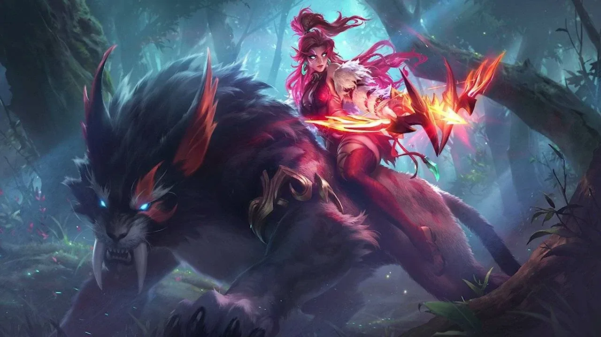

[All skins](https://boostmlbb.ru/en/skins/)

[Skins](https://boostmlbb.ru/en/skins/)/Irithel

# Irithel skins

Skins

7

In the shop

2

Latest

[Checkered Knight](https://boostmlbb.ru/en/skins/irithel/checkered-knight.html)2025

[Hero profile→](https://boostmlbb.ru/en/heroes/irithel.html)

## All skins

AllGrandExquisiteDeluxeExceptionalCommon

[Checkered KnightExceptional · 2025](https://boostmlbb.ru/en/skins/irithel/checkered-knight.html)[Monster SP RiderGrand · 2023](https://boostmlbb.ru/en/skins/irithel/monster-sp-rider.html)[Astral WandererExquisite · 2019](https://boostmlbb.ru/en/skins/irithel/astral-wanderer.html)[Sagit­tariusDeluxe · 2018](https://boostmlbb.ru/en/skins/irithel/sagittarius.html)[NightarrowExceptional · 2018](https://boostmlbb.ru/en/skins/irithel/nightarrow.html)[HellfireDeluxe · 2017](https://boostmlbb.ru/en/skins/irithel/hellfire.html)[Silver CycloneCommon · 2017](https://boostmlbb.ru/en/skins/irithel/silver-cyclone.html)

**How much is a rank boost on Irithel?**Choose your current and target ranks to see the price here.

[Calculate price](https://boostmlbb.ru/en/order.html?type=hero)

## Frequently asked questions

How many skins does Irithel have?

7 skins, the default look not counted. The newest is Checkered Knight (1 February 2025).

Which Irithel skins can you buy now?

Hellfire (899 diamonds), Silver Cyclone (269 diamonds). The other skins were limited and come back only in events.

What is the rarest Irithel skin?

Monster SP Rider, Grand class, Ducati series. Released in the MLBB × DUCATI event.
