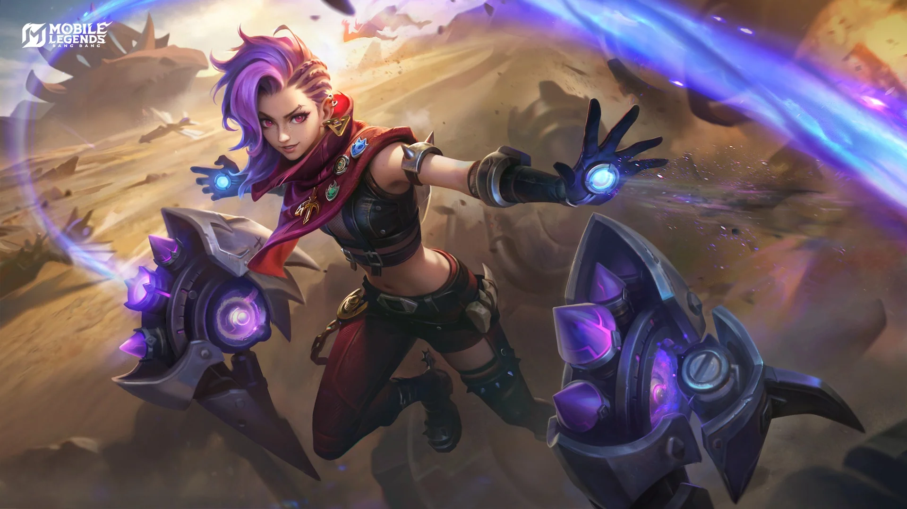

[Tier list](https://boostmlbb.ru/en/heroes/)[Items](https://boostmlbb.ru/en/items/)[Skins](https://boostmlbb.ru/en/skins/)[News & guides](https://boostmlbb.ru/en/news/)

[Skins](https://boostmlbb.ru/en/skins/)/Ixia

# Ixia skins

Skins

2

In the shop

1

Latest

[Dynamic Streak](https://boostmlbb.ru/en/skins/ixia/dynamic-streak.html)2024

[Hero profile→](https://boostmlbb.ru/en/heroes/ixia.html)

## All skins

[Dynamic StreakExceptional · 2024](https://boostmlbb.ru/en/skins/ixia/dynamic-streak.html)[Shifting SandCommon · 2023](https://boostmlbb.ru/en/skins/ixia/shifting-sand.html)

**Rank up on Ixia**The calculator shows the price

[Calculate price](https://boostmlbb.ru/en/order.html?type=hero)

## Frequently asked questions

How many skins does Ixia have?

2 skins, the default look not counted. The newest is Dynamic Streak (1 March 2024).

Which Ixia skins can you buy now?

Shifting Sand (269 diamonds). The other skins were limited and come back only in events.

What is the rarest Ixia skin?

Dynamic Streak, Exceptional class, StarLight series. StarLight reward for March 2024.
