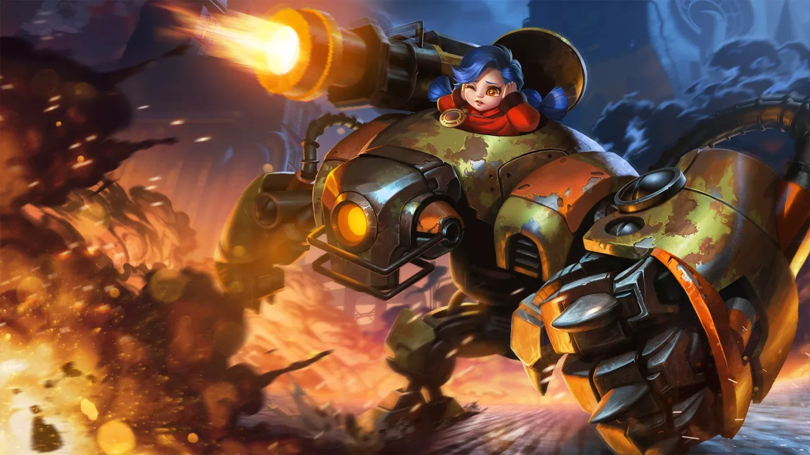

[Tier list](https://boostmlbb.ru/en/heroes/)[Items](https://boostmlbb.ru/en/items/)[Skins](https://boostmlbb.ru/en/skins/)[News & guides](https://boostmlbb.ru/en/news/)

[Skins](https://boostmlbb.ru/en/skins/)/Jawhead

# Jawhead skins

Skins

9

In the shop

3

Latest

[Proto Guardian](https://boostmlbb.ru/en/skins/jawhead/proto-guardian.html)2025

[Hero profile→](https://boostmlbb.ru/en/heroes/jawhead.html)

## All skins

AllExquisiteDeluxeExceptionalCommon

[Proto GuardianDeluxe · 2025](https://boostmlbb.ru/en/skins/jawhead/proto-guardian.html)[Victory LoaderCommon · 2024](https://boostmlbb.ru/en/skins/jawhead/victory-loader.html)[Cyber RangerExceptional · 2023](https://boostmlbb.ru/en/skins/jawhead/cyber-ranger.html)[Candy BearExceptional · 2021](https://boostmlbb.ru/en/skins/jawhead/candy-bear.html)[Samurai MechExquisite · 2020](https://boostmlbb.ru/en/skins/jawhead/samurai-mech.html)[Foo Quar­terbackCommon · 2019](https://boostmlbb.ru/en/skins/jawhead/foo-quarterback.html)[The NutcrackerExceptional · 2019](https://boostmlbb.ru/en/skins/jawhead/the-nutcracker.html)[Space ExplorerExceptional · 2018](https://boostmlbb.ru/en/skins/jawhead/space-explorer.html)[Girl ScoutCommon · 2018](https://boostmlbb.ru/en/skins/jawhead/girl-scout.html)

**Rank up on Jawhead**The calculator shows the price

[Calculate price](https://boostmlbb.ru/en/order.html?type=hero)

## Frequently asked questions

How many skins does Jawhead have?

9 skins, the default look not counted. The newest is Proto Guardian (5 July 2025).

Which Jawhead skins can you buy now?

Cyber Ranger (749 diamonds), The Nutcracker (749 diamonds), Girl Scout (269 diamonds). The other skins were limited and come back only in events.

What is the rarest Jawhead skin?

Samurai Mech, Exquisite class, Collector series. The top prize of a Collector event draw, paid with diamonds. Limited skins come back in event draws from time to time.
