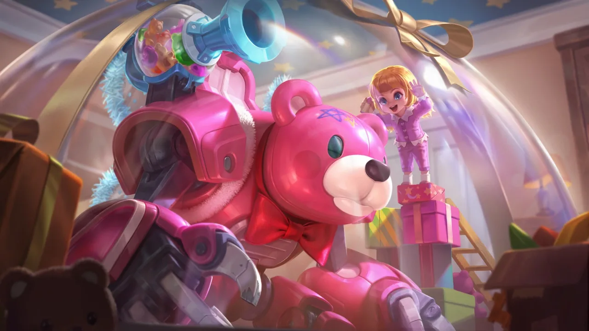

[Jawhead skins](https://boostmlbb.ru/en/skins/jawhead.html)

[Skins](https://boostmlbb.ru/en/skins/)/[Jawhead](https://boostmlbb.ru/en/skins/jawhead.html)/Candy Bear

[Jawhead skin](https://boostmlbb.ru/en/skins/jawhead.html)

# Candy Bear

ExceptionalStarLightLimited

How to get

StarLight reward for June 2021.

Released

1 June 2021

## What the skin changes

-   New look
-   New skill effects
-   Showcase animation
-   Showcase scene
-   Attribute bonus

## All Jawhead skins [9](https://boostmlbb.ru/en/skins/jawhead.html)

[Proto GuardianDeluxe · 2025](https://boostmlbb.ru/en/skins/jawhead/proto-guardian.html)[Victory LoaderCommon · 2024](https://boostmlbb.ru/en/skins/jawhead/victory-loader.html)[Cyber RangerExceptional · 2023](https://boostmlbb.ru/en/skins/jawhead/cyber-ranger.html)[Candy BearExceptional · 2021](https://boostmlbb.ru/en/skins/jawhead/candy-bear.html)[Samurai MechExquisite · 2020](https://boostmlbb.ru/en/skins/jawhead/samurai-mech.html)[Foo Quar­terbackCommon · 2019](https://boostmlbb.ru/en/skins/jawhead/foo-quarterback.html)[The NutcrackerExceptional · 2019](https://boostmlbb.ru/en/skins/jawhead/the-nutcracker.html)[Space ExplorerExceptional · 2018](https://boostmlbb.ru/en/skins/jawhead/space-explorer.html)[Girl ScoutCommon · 2018](https://boostmlbb.ru/en/skins/jawhead/girl-scout.html)

## StarLight series

[Tideborn SailorKalea · 2026](https://boostmlbb.ru/en/skins/kalea/tideborn-sailor.html)[Kitsune's ShadowHayabusa · 2026](https://boostmlbb.ru/en/skins/hayabusa/kitsune-s-shadow.html)[Fangs of SlaughterHanzo · 2026](https://boostmlbb.ru/en/skins/hanzo/fangs-of-slaughter.html)[Smoul­dering FortressBelerick · 2026](https://boostmlbb.ru/en/skins/belerick/smouldering-fortress.html)[Magitech WraithObsidia · 2026](https://boostmlbb.ru/en/skins/obsidia/magitech-wraith.html)[Elysian LuminanceZetian · 2026](https://boostmlbb.ru/en/skins/zetian/elysian-luminance.html)[Guardian BattalionHilda · 2026](https://boostmlbb.ru/en/skins/hilda/guardian-battalion.html)[Dreaming KoiHarley · 2026](https://boostmlbb.ru/en/skins/harley/dreaming-koi.html)

**How much is a rank boost on Jawhead?**Choose your current and target ranks to see the price here.

[Calculate price](https://boostmlbb.ru/en/order.html?type=hero)

## Frequently asked questions

How to get the Candy Bear skin for Jawhead?

StarLight reward for June 2021.

When was Candy Bear released?

1 June 2021.

What class is Candy Bear?

Exceptional, StarLight series.
